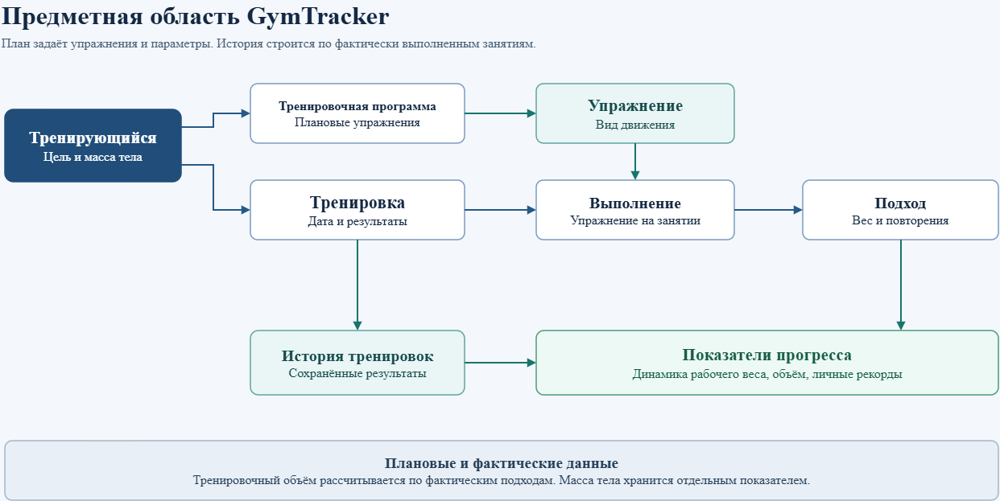
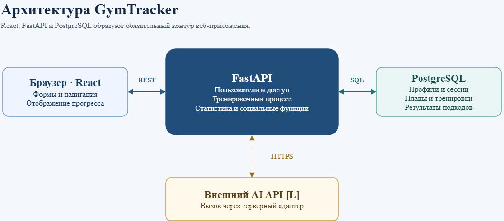

# GymTracker · Спецификация требований

Условия приёмки каждого требования сведены в [матрицу AT](06_Test_Matrices.md#at).

[Редакция на вики](https://se.cs.petrsu.ru/w/index.php?oldid=340456).

[На главную](00_Start.md) · [Документ проектирования](01_Architecture.md) · [План тестирования](03_Test_Plan.md)

## Требования к GymTracker

Редакция от 19.11.2026. В основной версии 25 обязательных функций. Всего для трёх приоритетов определены 66 функций и 31 ограничение. [Сценарии по экранам](#screen-contracts) · [Проектные решения](01_Architecture.md#trace) · [Покрытие тестами](03_Test_Plan.md#coverage).

Каждое из требований, предъявляемых к проектируемой системе, имеет один из следующих приоритетов:

- H - высокий;
- M - средний;
- L - низкий;

Категория определяет приоритет выполнения требований на последующих стадиях разработки. Первыми реализуются требования с высоким приоритетом, затем со средним и последними с низким. Предполагается, что требования с высоким приоритетом должны быть выполнены даже при сокращении времени разработки.

### Очерёдность реализации требований

Реализация GymTracker разделяется на обязательную и дополнительную функциональность.

**Обязательная функциональность**

В первую очередь реализуются требования с высоким приоритетом (H), необходимые для основных сценариев работы приложения:

- регистрация и авторизация;
- просмотр и редактирование собственного профиля;
- просмотр справочника упражнений;
- создание и редактирование тренировочных программ;
- запись выполненных упражнений и подходов;
- сохранение тренировок;
- просмотр истории тренировок;
- просмотр количества тренировок и изменения рабочего веса;
- навигация и обработка результатов пользовательских операций.

Обязательные функции должны быть доступны независимо от реализации социальных функций и AI-помощника.

**Дополнительная функциональность среднего приоритета**

После завершения обязательной функциональности могут реализовываться требования с приоритетом M:

- расширенные показатели и графики;
- запись и просмотр истории изменения массы тела;
- управление видимостью персональных показателей;
- личные рекорды и достижения;
- поиск друзей и взаимодействие с ними;
- административные функции;
- дополнительные возможности редактирования и просмотра данных.

**Дополнительная функциональность низкого приоритета**

Функции с приоритетом L реализуются при наличии времени:

- группы и групповые рейтинги;
- дополнительные уведомления;
- AI-помощник.

Указанная очерёдность соответствует ограничениям первой версии, приведённым в плане проекта.

При недостатке времени допускается перенос дополнительных функций на последующие версии без нарушения основных сценариев работы GymTracker.

### Функциональные требования

#### 1. Регистрация (H)

1.1. Гость может зарегистрировать новую учётную запись с помощью e-mail и пароля (H). [Проектное решение](01_Architecture.md#trace-ft-1-1) · [Проверки](03_Test_Plan.md#test-ft-1-1)

#### 2. Авторизация (H)

2.1. Пользователь может войти в систему с помощью e-mail и пароля (H). [Проектное решение](01_Architecture.md#trace-ft-2-1) · [Проверки](03_Test_Plan.md#test-ft-2-1)

2.2. Пользователь может выйти из учётной записи (H). [Проектное решение](01_Architecture.md#trace-ft-2-2) · [Проверки](03_Test_Plan.md#test-ft-2-2)

2.3. Пользователь может оставаться авторизованным между сеансами работы с приложением (M). [Проектное решение](01_Architecture.md#trace-ft-2-3) · [Проверки](03_Test_Plan.md#test-ft-2-3)

#### 3. Профиль пользователя (H)

3.1. Пользователь может просмотреть собственный профиль (H). [Проектное решение](01_Architecture.md#trace-ft-3-1) · [Проверки](03_Test_Plan.md#test-ft-3-1)

3.2. Пользователь может изменить данные собственного профиля (H). [Проектное решение](01_Architecture.md#trace-ft-3-2) · [Проверки](03_Test_Plan.md#test-ft-3-2)

3.3. Пользователь может указать рост, массу тела и цель тренировок (H). [Проектное решение](01_Architecture.md#trace-ft-3-3) · [Проверки](03_Test_Plan.md#test-ft-3-3)

3.4. Пользователь может просмотреть основные показатели прогресса в профиле (M). [Проектное решение](01_Architecture.md#trace-ft-3-4) · [Проверки](03_Test_Plan.md#test-ft-3-4)

3.5. Пользователь может изменить настройки доступности собственной массы тела и тренировочной статистики для друзей (M). [Проектное решение](01_Architecture.md#trace-ft-3-5) · [Проверки](03_Test_Plan.md#test-ft-3-5)

#### 4. Справочник упражнений (H)

4.1. Пользователь может просмотреть список доступных упражнений (H). [Проектное решение](01_Architecture.md#trace-ft-4-1) · [Проверки](03_Test_Plan.md#test-ft-4-1)

4.2. Пользователь может просмотреть информацию о выбранном упражнении (M). [Проектное решение](01_Architecture.md#trace-ft-4-2) · [Проверки](03_Test_Plan.md#test-ft-4-2)

4.3. Пользователь может выполнить поиск упражнения по названию (M). [Проектное решение](01_Architecture.md#trace-ft-4-3) · [Проверки](03_Test_Plan.md#test-ft-4-3)

#### 5. Тренировочные программы (H)

5.1. Пользователь может просмотреть список собственных тренировочных программ (H). [Проектное решение](01_Architecture.md#trace-ft-5-1) · [Проверки](03_Test_Plan.md#test-ft-5-1)

5.2. Пользователь может создать тренировочную программу (H). [Проектное решение](01_Architecture.md#trace-ft-5-2) · [Проверки](03_Test_Plan.md#test-ft-5-2)

5.3. Пользователь может добавить упражнения в тренировочную программу (H). [Проектное решение](01_Architecture.md#trace-ft-5-3) · [Проверки](03_Test_Plan.md#test-ft-5-3)

5.4. Пользователь может указать планируемое количество подходов и повторений (H). [Проектное решение](01_Architecture.md#trace-ft-5-4) · [Проверки](03_Test_Plan.md#test-ft-5-4)

5.5. Пользователь может изменить созданную тренировочную программу (H). [Проектное решение](01_Architecture.md#trace-ft-5-5) · [Проверки](03_Test_Plan.md#test-ft-5-5)

5.6. Пользователь может удалить собственную тренировочную программу (M). [Проектное решение](01_Architecture.md#trace-ft-5-6) · [Проверки](03_Test_Plan.md#test-ft-5-6)

#### 6. Запись тренировок (H)

6.1. Пользователь может создать новую тренировку (H). [Проектное решение](01_Architecture.md#trace-ft-6-1) · [Проверки](03_Test_Plan.md#test-ft-6-1)

6.2. Пользователь может добавить упражнение в тренировку (H). [Проектное решение](01_Architecture.md#trace-ft-6-2) · [Проверки](03_Test_Plan.md#test-ft-6-2)

6.3. Пользователь может добавить подход к выполненному упражнению (H). [Проектное решение](01_Architecture.md#trace-ft-6-3) · [Проверки](03_Test_Plan.md#test-ft-6-3)

6.4. Пользователь может указать количество повторений в подходе (H). [Проектное решение](01_Architecture.md#trace-ft-6-4) · [Проверки](03_Test_Plan.md#test-ft-6-4)

6.5. Пользователь может указать рабочий вес (H). [Проектное решение](01_Architecture.md#trace-ft-6-5) · [Проверки](03_Test_Plan.md#test-ft-6-5)

6.6. Пользователь может сохранить тренировку (H). [Проектное решение](01_Architecture.md#trace-ft-6-6) · [Проверки](03_Test_Plan.md#test-ft-6-6)

6.7. Пользователь может изменить собственную ранее сохранённую тренировку (M). [Проектное решение](01_Architecture.md#trace-ft-6-7) · [Проверки](03_Test_Plan.md#test-ft-6-7)

6.8. Пользователь может удалить собственную тренировку (M). [Проектное решение](01_Architecture.md#trace-ft-6-8) · [Проверки](03_Test_Plan.md#test-ft-6-8)

#### 7. История тренировок (H)

7.1. Пользователь может просмотреть список ранее выполненных тренировок (H). [Проектное решение](01_Architecture.md#trace-ft-7-1) · [Проверки](03_Test_Plan.md#test-ft-7-1)

7.2. Пользователь может просмотреть подробную информацию о выбранной тренировке (H). [Проектное решение](01_Architecture.md#trace-ft-7-2) · [Проверки](03_Test_Plan.md#test-ft-7-2)

7.3. Пользователь может выбрать период отображения истории тренировок (M). [Проектное решение](01_Architecture.md#trace-ft-7-3) · [Проверки](03_Test_Plan.md#test-ft-7-3)

7.4. Пользователь может отфильтровать историю по упражнению (M). [Проектное решение](01_Architecture.md#trace-ft-7-4) · [Проверки](03_Test_Plan.md#test-ft-7-4)

#### 8. Статистика и прогресс (H)

8.1. Пользователь может просмотреть количество проведённых тренировок (H). [Проектное решение](01_Architecture.md#trace-ft-8-1) · [Проверки](03_Test_Plan.md#test-ft-8-1)

8.2. Пользователь может просмотреть изменение рабочего веса выбранного упражнения (H). [Проектное решение](01_Architecture.md#trace-ft-8-2) · [Проверки](03_Test_Plan.md#test-ft-8-2)

8.3. Пользователь может просмотреть изменение собственной массы тела (M). [Проектное решение](01_Architecture.md#trace-ft-8-3) · [Проверки](03_Test_Plan.md#test-ft-8-3)

8.4. Пользователь может просмотреть тренировочный объём за выбранный период (M). [Проектное решение](01_Architecture.md#trace-ft-8-4) · [Проверки](03_Test_Plan.md#test-ft-8-4)

8.5. Пользователь может просмотреть график прогресса выбранного упражнения (M). [Проектное решение](01_Architecture.md#trace-ft-8-5) · [Проверки](03_Test_Plan.md#test-ft-8-5)

8.6. Пользователь может выбрать период отображения графика прогресса (M). [Проектное решение](01_Architecture.md#trace-ft-8-6) · [Проверки](03_Test_Plan.md#test-ft-8-6)

8.7. Пользователь может сохранить измерение собственной массы тела с указанием даты и значения (M). [Проектное решение](01_Architecture.md#trace-ft-8-7) · [Проверки](03_Test_Plan.md#test-ft-8-7)

8.8. Пользователь может изменить ранее сохранённое измерение собственной массы тела (M). [Проектное решение](01_Architecture.md#trace-ft-8-8) · [Проверки](03_Test_Plan.md#test-ft-8-8)

#### 9. Личные рекорды и достижения (M)

9.1. Пользователь может просмотреть свои личные рекорды (M). [Проектное решение](01_Architecture.md#trace-ft-9-1) · [Проверки](03_Test_Plan.md#test-ft-9-1)

9.2. Система может автоматически определить новый личный рекорд после сохранения тренировки (M). [Проектное решение](01_Architecture.md#trace-ft-9-2) · [Проверки](03_Test_Plan.md#test-ft-9-2)

9.3. Пользователь может просмотреть полученные достижения (M). [Проектное решение](01_Architecture.md#trace-ft-9-3) · [Проверки](03_Test_Plan.md#test-ft-9-3)

9.4. Система может автоматически выдавать достижение после выполнения заданного условия (M). [Проектное решение](01_Architecture.md#trace-ft-9-4) · [Проверки](03_Test_Plan.md#test-ft-9-4)

#### 10. Друзья (M)

10.1. Пользователь может найти другого зарегистрированного пользователя (M). [Проектное решение](01_Architecture.md#trace-ft-10-1) · [Проверки](03_Test_Plan.md#test-ft-10-1)

10.2. Пользователь может отправить запрос на добавление в друзья (M). [Проектное решение](01_Architecture.md#trace-ft-10-2) · [Проверки](03_Test_Plan.md#test-ft-10-2)

10.3. Пользователь может принять или отклонить запрос в друзья (M). [Проектное решение](01_Architecture.md#trace-ft-10-3) · [Проверки](03_Test_Plan.md#test-ft-10-3)

10.4. Пользователь может удалить пользователя из списка друзей (M). [Проектное решение](01_Architecture.md#trace-ft-10-4) · [Проверки](03_Test_Plan.md#test-ft-10-4)

10.5. Пользователь может просмотреть доступную информацию профиля друга (M). [Проектное решение](01_Architecture.md#trace-ft-10-5) · [Проверки](03_Test_Plan.md#test-ft-10-5)

#### 11. Группы и рейтинги (L)

11.1. Пользователь может создать группу (L). [Проектное решение](01_Architecture.md#trace-ft-11-1) · [Проверки](03_Test_Plan.md#test-ft-11-1)

11.2. Пользователь может вступить в группу (L). [Проектное решение](01_Architecture.md#trace-ft-11-2) · [Проверки](03_Test_Plan.md#test-ft-11-2)

11.3. Пользователь может покинуть группу (L). [Проектное решение](01_Architecture.md#trace-ft-11-3) · [Проверки](03_Test_Plan.md#test-ft-11-3)

11.4. Пользователь может просмотреть участников группы (L). [Проектное решение](01_Architecture.md#trace-ft-11-4) · [Проверки](03_Test_Plan.md#test-ft-11-4)

11.5. Пользователь может просмотреть рейтинг участников группы (L). [Проектное решение](01_Architecture.md#trace-ft-11-5) · [Проверки](03_Test_Plan.md#test-ft-11-5)

#### 12. AI-помощник (L)

12.1. Пользователь может отправить текстовый запрос AI-помощнику (L). [Проектное решение](01_Architecture.md#trace-ft-12-1) · [Проверки](03_Test_Plan.md#test-ft-12-1)

12.2. Пользователь может получить ответ AI-помощника (L). [Проектное решение](01_Architecture.md#trace-ft-12-2) · [Проверки](03_Test_Plan.md#test-ft-12-2)

12.3. Пользователь может запросить анализ своей истории тренировок (L). [Проектное решение](01_Architecture.md#trace-ft-12-3) · [Проверки](03_Test_Plan.md#test-ft-12-3)

12.4. Пользователь может запросить пример тренировки по заданным параметрам (L). [Проектное решение](01_Architecture.md#trace-ft-12-4) · [Проверки](03_Test_Plan.md#test-ft-12-4)

#### 13. Уведомления (L)

13.1. Пользователь может получить уведомление о новом достижении (L). [Проектное решение](01_Architecture.md#trace-ft-13-1) · [Проверки](03_Test_Plan.md#test-ft-13-1)

13.2. Пользователь может получить уведомление о запросе на добавление в друзья (L). [Проектное решение](01_Architecture.md#trace-ft-13-2) · [Проверки](03_Test_Plan.md#test-ft-13-2)

#### 14. Администрирование (M)

14.1. Администратор может просмотреть список пользователей (M). [Проектное решение](01_Architecture.md#trace-ft-14-1) · [Проверки](03_Test_Plan.md#test-ft-14-1)

14.2. Администратор может заблокировать пользователя (M). [Проектное решение](01_Architecture.md#trace-ft-14-2) · [Проверки](03_Test_Plan.md#test-ft-14-2)

14.3. Администратор может добавить упражнение в общий справочник (M). [Проектное решение](01_Architecture.md#trace-ft-14-3) · [Проверки](03_Test_Plan.md#test-ft-14-3)

14.4. Администратор может изменить информацию об упражнении (M). [Проектное решение](01_Architecture.md#trace-ft-14-4) · [Проверки](03_Test_Plan.md#test-ft-14-4)

14.5. Администратор может разблокировать ранее заблокированного пользователя (M). [Проектное решение](01_Architecture.md#trace-ft-14-5) · [Проверки](03_Test_Plan.md#test-ft-14-5)

#### 15. Навигация и общие функции (H)

15.1. Пользователь может переключаться между основными разделами приложения (H). [Проектное решение](01_Architecture.md#trace-ft-15-1) · [Проверки](03_Test_Plan.md#test-ft-15-1)

15.2. Система сообщает пользователю о результате выполнения операции (H). [Проектное решение](01_Architecture.md#trace-ft-15-2) · [Проверки](03_Test_Plan.md#test-ft-15-2)

15.3. При невозможности выполнения операции система сообщает пользователю об ошибке (H). [Проектное решение](01_Architecture.md#trace-ft-15-3) · [Проверки](03_Test_Plan.md#test-ft-15-3)

### Функциональные ограничения

#### 1. Ограничения доступа и прав

1.1. В системе используются роли: гость, зарегистрированный пользователь и администратор (H). [Проектное решение](01_Architecture.md#trace-fo-1-1) · [Проверки](03_Test_Plan.md#test-fo-1-1)

1.2. Функции ведения тренировок доступны только зарегистрированным пользователям (H). [Проектное решение](01_Architecture.md#trace-fo-1-2) · [Проверки](03_Test_Plan.md#test-fo-1-2)

1.3. Пользователь может изменять только собственный профиль, собственные тренировочные программы и собственные тренировки (H). [Проектное решение](01_Architecture.md#trace-fo-1-3) · [Проверки](03_Test_Plan.md#test-fo-1-3)

1.4. Пользователь не может изменять тренировочные данные другого пользователя (H). [Проектное решение](01_Architecture.md#trace-fo-1-4) · [Проверки](03_Test_Plan.md#test-fo-1-4)

1.5. Административные функции доступны только администратору (H). [Проектное решение](01_Architecture.md#trace-fo-1-5) · [Проверки](03_Test_Plan.md#test-fo-1-5)

#### 2. Ограничения регистрации и пользовательских данных

2.1. Для одного адреса электронной почты может существовать только одна учётная запись (H). [Проектное решение](01_Architecture.md#trace-fo-2-1) · [Проверки](03_Test_Plan.md#test-fo-2-1)

2.2. Пароли пользователей не хранятся в открытом виде (H). [Проектное решение](01_Architecture.md#trace-fo-2-2) · [Проверки](03_Test_Plan.md#test-fo-2-2)

2.3. Введённые при регистрации и авторизации данные проходят проверку серверной частью приложения (H). [Проектное решение](01_Architecture.md#trace-fo-2-3) · [Проверки](03_Test_Plan.md#test-fo-2-3)

2.4. Данные профиля, тренировочные программы и результаты тренировок хранятся в базе данных (H). [Проектное решение](01_Architecture.md#trace-fo-2-4) · [Проверки](03_Test_Plan.md#test-fo-2-4)

#### 3. Ограничения тренировочных данных

3.1. Количество подходов задаётся целым положительным числом (H). [Проектное решение](01_Architecture.md#trace-fo-3-1) · [Проверки](03_Test_Plan.md#test-fo-3-1)

3.2. Количество повторений задаётся целым неотрицательным числом (H). [Проектное решение](01_Architecture.md#trace-fo-3-2) · [Проверки](03_Test_Plan.md#test-fo-3-2)

3.3. Рабочий вес не может иметь отрицательное значение (H). [Проектное решение](01_Architecture.md#trace-fo-3-3) · [Проверки](03_Test_Plan.md#test-fo-3-3)

3.4. Рост и масса тела пользователя задаются положительными числовыми значениями (H). [Проектное решение](01_Architecture.md#trace-fo-3-4) · [Проверки](03_Test_Plan.md#test-fo-3-4)

3.5. Каждая тренировка принадлежит конкретному пользователю (H). [Проектное решение](01_Architecture.md#trace-fo-3-5) · [Проверки](03_Test_Plan.md#test-fo-3-5)

3.6. Каждый подход относится к конкретному выполненному упражнению (H). [Проектное решение](01_Architecture.md#trace-fo-3-6) · [Проверки](03_Test_Plan.md#test-fo-3-6)

3.7. Изменение или удаление тренировочных данных не должно нарушать связи между тренировкой, упражнениями и подходами (H). [Проектное решение](01_Architecture.md#trace-fo-3-7) · [Проверки](03_Test_Plan.md#test-fo-3-7)

#### 4. Ограничения статистики

4.1. Статистика рассчитывается только на основании сохранённых тренировочных данных (H). [Проектное решение](01_Architecture.md#trace-fo-4-1) · [Проверки](03_Test_Plan.md#test-fo-4-1)

4.2. Графики строятся только при наличии необходимых данных (M). [Проектное решение](01_Architecture.md#trace-fo-4-2) · [Проверки](03_Test_Plan.md#test-fo-4-2)

4.3. Изменение сохранённой тренировки должно учитываться при последующем расчёте статистики (M). [Проектное решение](01_Architecture.md#trace-fo-4-3) · [Проверки](03_Test_Plan.md#test-fo-4-3)

#### 5. Ограничения социальных функций

5.1. Социальные функции доступны только зарегистрированным пользователям (M). [Проектное решение](01_Architecture.md#trace-fo-5-1) · [Проверки](03_Test_Plan.md#test-fo-5-1)

5.2. Пользователь не может изменять результаты другого пользователя (H). [Проектное решение](01_Architecture.md#trace-fo-5-2) · [Проверки](03_Test_Plan.md#test-fo-5-2)

5.3. Скрытые данные пользователя не отображаются другим пользователям (M). [Проектное решение](01_Architecture.md#trace-fo-5-3) · [Проверки](03_Test_Plan.md#test-fo-5-3)

#### 6. Ограничения AI-помощника

6.1. AI-помощник является дополнительной функцией системы (L). [Проектное решение](01_Architecture.md#trace-fo-6-1) · [Проверки](03_Test_Plan.md#test-fo-6-1)

6.2. Основная функциональность GymTracker должна работать независимо от доступности AI-помощника (H). [Проектное решение](01_Architecture.md#trace-fo-6-2) · [Проверки](03_Test_Plan.md#test-fo-6-2)

6.3. AI-помощник не изменяет тренировочные данные пользователя автоматически (H). [Проектное решение](01_Architecture.md#trace-fo-6-3) · [Проверки](03_Test_Plan.md#test-fo-6-3)

6.4. Ответ AI-помощника носит информационный характер и не является медицинской рекомендацией (H). [Проектное решение](01_Architecture.md#trace-fo-6-4) · [Проверки](03_Test_Plan.md#test-fo-6-4)

#### 7. Ограничения платформы

7.1. GymTracker представляет собой веб-приложение (H). [Проектное решение](01_Architecture.md#trace-fo-7-1) · [Проверки](03_Test_Plan.md#test-fo-7-1)

7.2. Для работы приложения требуется современный веб-браузер (H). [Проектное решение](01_Architecture.md#trace-fo-7-2) · [Проверки](03_Test_Plan.md#test-fo-7-2)

7.3. Отдельное мобильное приложение в рамках проекта не разрабатывается (M). [Проектное решение](01_Architecture.md#trace-fo-7-3) · [Проверки](03_Test_Plan.md#test-fo-7-3)

7.4. Синхронизация с фитнес-браслетами и умными часами не поддерживается (L). [Проектное решение](01_Architecture.md#trace-fo-7-4) · [Проверки](03_Test_Plan.md#test-fo-7-4)

7.5. Анализ техники выполнения упражнений по видео не поддерживается (L). [Проектное решение](01_Architecture.md#trace-fo-7-5) · [Проверки](03_Test_Plan.md#test-fo-7-5)

## Модели требований

### Модель предметной области

Предметной областью проекта GymTracker является организация силовых тренировок, ведение тренировочного процесса и анализ физических результатов.

Тренировочный процесс включает планирование занятий, выполнение физических упражнений, фиксацию результатов и оценку изменения показателей во времени.

Модель предметной области описывает понятия тренировочного процесса независимо от способа их хранения и отображения в разрабатываемом программном обеспечении.

#### Основные понятия предметной области

1.  **Тренирующийся** - человек, который выполняет физические упражнения с целью развития силы, выносливости, набора мышечной массы или поддержания физической формы.

<!-- -->

1.  **Цель тренировки** - желаемый результат тренировочного процесса, например увеличение силы, развитие мышц или улучшение общей физической подготовки.

<!-- -->

1.  **Тренировочная программа** - заранее составленный план занятий, определяющий используемые упражнения, их последовательность и предполагаемую нагрузку.

<!-- -->

1.  **Тренировка** - отдельное занятие физическими упражнениями, проводимое в определённую дату.

<!-- -->

1.  **Упражнение** - физическое действие, направленное на тренировку определённых мышц или развитие физических качеств.

<!-- -->

1.  **Выполнение упражнения** - выполнение конкретного упражнения в рамках тренировочного занятия.

<!-- -->

1.  **Подход** - последовательность повторений упражнения, выполняемых без продолжительного перерыва.

<!-- -->

1.  **Повторение** - одно полное выполнение движения в рамках упражнения.

<!-- -->

1.  **Рабочий вес** - масса внешнего отягощения, используемого при выполнении упражнения.

<!-- -->

1.  **Нагрузка** - совокупность параметров выполнения упражнения, включая используемый вес, количество подходов и повторений.

<!-- -->

1.  **Результат упражнения** - фактически выполненное количество подходов и повторений с указанием использованного веса, если он применялся.

<!-- -->

1.  **Результат тренировки** - совокупность результатов упражнений, выполненных за одно тренировочное занятие.

<!-- -->

1.  **История тренировок** - последовательность проведённых тренировок и их результатов за определённый период.

<!-- -->

1.  **Тренировочный объём** - количественный показатель выполненной работы. Для упражнений с внешним отягощением рассчитывается как сумма произведений рабочего веса на количество повторений по выполненным подходам.

<!-- -->

1.  **Масса тела** - физический показатель тренирующегося, изменение которого может учитываться при оценке результатов тренировочного процесса.

<!-- -->

1.  **Личный рекорд** - наилучший результат тренирующегося по определённому показателю упражнения, например максимальному рабочему весу.

<!-- -->

1.  **Прогресс** - изменение тренировочных результатов или физических показателей человека за определённый период.

#### Взаимосвязи между понятиями

1.  Тренирующийся имеет одну или несколько целей тренировочного процесса.
2.  Для достижения цели может составляться тренировочная программа.
3.  Тренировочная программа определяет планируемые упражнения и параметры их выполнения.
4.  Тренирующийся выполняет тренировки.
5.  Тренировка включает одно или несколько выполнений упражнений.
6.  Каждое выполнение упражнения относится к определённому упражнению.
7.  Выполнение упражнения состоит из подходов.
8.  Подход характеризуется количеством повторений и при необходимости рабочим весом.
9.  Совокупность подходов определяет результат выполнения упражнения.
10. Результаты упражнений формируют общий результат тренировки.
11. Последовательность результатов тренировок образует историю тренировок.
12. История тренировок используется для оценки прогресса.
13. На основании результатов подходов может рассчитываться тренировочный объём.
14. При сравнении результатов одного упражнения может быть определён личный рекорд.

#### Схема взаимосвязей понятий

Схема отражает основные связи между понятиями тренировочного процесса.

Тренирующийся определяет цель тренировок, для достижения которой может использоваться тренировочная программа. Программа содержит планируемые упражнения.

Во время тренировки выполняются упражнения, состоящие из подходов. Подход характеризуется количеством повторений и, при необходимости, рабочим весом.

Результаты отдельных упражнений формируют результат тренировки. Последовательность результатов образует историю тренировок, на основании которой можно оценивать прогресс и определять личные рекорды.

На схеме представлены понятия предметной области, а не классы, таблицы или элементы интерфейса разрабатываемого приложения.

#### Пример тренировочного процесса

Человек планирует тренировку грудных мышц и включает в неё жим гантелей.

Во время занятия он выполняет три подхода по десять повторений с рабочим весом 30 кг.

Результат упражнения:

- упражнение - жим гантелей;
- количество подходов - 3;
- количество повторений - 10 в каждом подходе;
- рабочий вес - 30 кг.

При условии, что рабочий вес 30 кг рассматривается как общая масса отягощения, тренировочный объём упражнения составляет:

30 \* 10 \* 3 = 900 кг-повторений.

Если при следующей тренировке человек выполняет то же упражнение с большим рабочим весом при сопоставимом количестве повторений, изменение результата может использоваться для оценки прогресса.

Полученные результаты включаются в историю тренировок и могут сравниваться с предыдущими результатами.

### Правила интерпретации тренировочных данных в GymTracker

Данный раздел уточняет правила представления и интерпретации тренировочных данных в системе GymTracker. Описанные правила применяются при детализации требований к подсистемам и проектировании структуры хранения данных.

#### Тренировочная программа и проведённая тренировка

Тренировочная программа представляет собой план выполнения упражнений с заданными параметрами нагрузки.

Тренировка представляет собой запись о фактически проведённом занятии.

В обязательной версии GymTracker создание и заполнение тренировки выполняется отдельно от редактирования тренировочной программы.

Автоматическое создание тренировки на основе программы не относится к обязательным функциям первой версии.

Возможность использования программы как шаблона для начала тренировки может быть рассмотрена при дальнейшем развитии приложения.

#### Представление рабочего веса

Рабочий вес указывается в килограммах.

В GymTracker под рабочим весом понимается суммарная масса внешнего отягощения, используемого при выполнении подхода.

Для упражнения с одной гантелью указывается масса этой гантели.

Для упражнения с двумя гантелями указывается суммарная масса обеих гантелей.

Например, при использовании двух гантелей массой 15 кг каждая рабочий вес составляет 30 кг.

При выполнении упражнения без дополнительного внешнего отягощения рабочий вес может быть равен 0 кг.

Масса тела тренирующегося не прибавляется автоматически к рабочему весу.

#### Тренировочный объём

Для упражнений с дополнительным внешним отягощением тренировочный объём рассчитывается по формуле:

V = сумма(Wi \* Ri),

где:

- V - тренировочный объём;
- Wi - рабочий вес i-го подхода;
- Ri - количество повторений в i-м подходе.

Пример:

Упражнение выполнено в трёх подходах:

- первый подход - 30 кг, 10 повторений;
- второй подход - 30 кг, 10 повторений;
- третий подход - 30 кг, 8 повторений.

Тренировочный объём составляет:

V = 30 \* 10 + 30 \* 10 + 30 \* 8 = 840.

Полученное значение характеризует объём работы с внешним отягощением в килограмм-повторениях.

Для упражнений без внешнего отягощения данный показатель не используется как основная характеристика нагрузки. Результаты таких упражнений могут оцениваться по количеству подходов и повторений.

#### Изменение рабочего веса

Для отображения изменения рабочего веса выбранного упражнения используется максимальный рабочий вес, зафиксированный для данного упражнения в каждой сохранённой тренировке.

В расчёт включаются подходы, в которых выполнено хотя бы одно повторение.

Результаты сравниваются в хронологическом порядке по датам тренировок.

Если для выбранного упражнения отсутствуют необходимые результаты, система сообщает о недостаточности данных.

#### Личный рекорд

Личным рекордом по рабочему весу считается наибольший сохранённый рабочий вес, с которым тренирующийся выполнил хотя бы одно повторение выбранного упражнения.

Рекорд определяется отдельно для каждого упражнения.

Если новый сохранённый результат превышает предыдущий максимальный рабочий вес, может быть зафиксирован новый личный рекорд.

Для упражнений без внешнего отягощения рекорды по рабочему весу не определяются. Возможные дополнительные виды рекордов могут быть рассмотрены позднее.

#### Измерения массы тела

Текущее значение массы тела может указываться в профиле пользователя.

После реализации истории измерений пользователь получает возможность сохранять отдельные значения массы тела с датами и изменять ранее сохранённые измерения.

Измерения используются для отображения динамики массы тела по датам.

При наличии истории измерений актуальное значение массы тела в профиле должно соответствовать последнему сохранённому измерению по дате. До реализации истории масса тела хранится как текущее значение профиля.

#### Связь с функциональными требованиями

- Тренировочные программы - ФТ 5.1-5.6.
- Запись тренировок и рабочего веса - ФТ 6.1-6.8.
- История тренировок - ФТ 7.1-7.4.
- Изменение рабочего веса - ФТ 8.2.
- История массы тела - ФТ 8.3, 8.7, 8.8.
- Тренировочный объём - ФТ 8.4.
- Личные рекорды - ФТ 9.1, 9.2.

Ключи, связи и порядок вычисления показателей описаны в [структурах данных](01_Architecture.md#data-structures) и [алгоритмах](01_Architecture.md#algorithms).

### Модель пользователей системы

В GymTracker предусмотрены три основные роли:

1.  Гость.
2.  Зарегистрированный пользователь.
3.  Администратор.

Для каждой роли определяются доступные функции и ограничения. После описания возможности указываются соответствующие функциональные требования (ФТ) и функциональные ограничения (ФО).

#### Гость

Гость - человек, который открыл веб-приложение, но не выполнил авторизацию.

**Возможности гостя:**

- Зарегистрировать новую учётную запись (ФТ 1.1; ФО 1.1, 2.1-2.3).
- Выполнить вход по e-mail и паролю (ФТ 2.1; ФО 1.1, 2.3).
- Перейти между доступными общедоступными разделами (ФТ 15.1; ФО 1.1, 1.2).

**Ограничения гостя:**

- Не может создавать и изменять тренировочные программы (ФО 1.2).
- Не может сохранять тренировки и просматривать личную историю (ФО 1.2).
- Не может использовать персональную статистику (ФО 1.2).
- Не может использовать социальные функции (ФО 5.1).
- Не имеет доступа к административным функциям (ФО 1.5).

#### Зарегистрированный пользователь

Зарегистрированный пользователь - человек, который имеет учётную запись GymTracker и использует систему для планирования, записи и анализа тренировок.

**Возможности зарегистрированного пользователя:**

- Выполнить вход и выход из учётной записи (ФТ 2.1, 2.2; ФО 1.2, 2.3).
- Сохранить авторизацию между сеансами работы (ФТ 2.3; ФО 2.3).
- Просмотреть собственный профиль (ФТ 3.1; ФО 1.3, 2.4).
- Изменить данные профиля, включая рост, массу тела и цель тренировок (ФТ 3.2, 3.3; ФО 1.3, 3.4).
- Изменить доступность собственной массы тела и тренировочной статистики для друзей при реализации социальной функциональности (ФТ 3.5; ФО 1.3, 5.3).
- Просмотреть основные показатели профиля (ФТ 3.4; ФО 4.1).
- Просмотреть справочник упражнений и найти нужное упражнение (ФТ 4.1-4.3; ФО 1.2).
- Создать тренировочную программу и добавить в неё упражнения (ФТ 5.2, 5.3; ФО 1.2, 1.3, 2.4).
- Указать планируемые подходы и повторения (ФТ 5.4; ФО 3.1, 3.2).
- Просмотреть, изменить или удалить собственную программу (ФТ 5.1, 5.5, 5.6; ФО 1.3, 2.4).
- Создать тренировку и добавить упражнения (ФТ 6.1, 6.2; ФО 1.2, 3.5).
- Добавить подход и указать количество повторений и рабочий вес (ФТ 6.3-6.5; ФО 3.2, 3.3, 3.6).
- Сохранить, изменить или удалить собственную тренировку (ФТ 6.6-6.8; ФО 1.3, 3.5-3.7).
- Просмотреть историю и подробности собственных тренировок (ФТ 7.1, 7.2; ФО 1.3, 3.5).
- Использовать фильтры истории тренировок (ФТ 7.3, 7.4; ФО 1.3).
- Просмотреть статистику тренировок и динамику рабочего веса (ФТ 8.1, 8.2; ФО 4.1).
- Просмотреть изменение массы тела и тренировочного объёма (ФТ 8.3, 8.4; ФО 4.1).
- Сохранить новое измерение массы тела с датой (ФТ 8.7; ФО 1.3, 3.4).
- Изменить ранее сохранённое измерение собственной массы тела (ФТ 8.8; ФО 1.3, 3.4).
- Просмотреть график прогресса и изменить период отображения (ФТ 8.5, 8.6; ФО 4.1, 4.2).
- Просмотреть личные рекорды и достижения (ФТ 9.1-9.4; ФО 4.1).
- Найти пользователей, добавить их в друзья и управлять списком друзей (ФТ 10.1-10.4; ФО 5.1).
- Просмотреть разрешённую информацию профиля друга (ФТ 10.5; ФО 5.2, 5.3).
- Создавать группы и участвовать в них при реализации этой функции (ФТ 11.1-11.4; ФО 5.1).
- Просмотреть рейтинг группы при реализации этой функции (ФТ 11.5; ФО 4.1, 5.1).
- Отправить запрос AI-помощнику и получить ответ при реализации функции (ФТ 12.1-12.4; ФО 6.1-6.4).
- Получать уведомления о достижениях и запросах в друзья при реализации функции (ФТ 13.1, 13.2; ФО 5.1).
- Переключаться между основными разделами приложения (ФТ 15.1; ФО 1.2, 7.1, 7.2).
- Получать сообщения о результатах операций и обнаруженных ошибках (ФТ 15.2, 15.3; ФО 2.3, 3.1-3.4).

**Ограничения зарегистрированного пользователя:**

- Не может изменять профиль и тренировочные данные другого пользователя (ФО 1.3, 1.4).
- Не может просматривать данные, скрытые настройками доступа (ФО 5.3).
- Масса тела и тренировочная статистика других пользователей не должны отображаться без разрешения их владельцев. По умолчанию эти показатели скрыты от других пользователей (ФО 5.3).
- Не может выполнять административные действия (ФО 1.5).

#### Администратор

Администратор - зарегистрированный пользователь с дополнительными правами управления системой.

Администратор обладает основными возможностями зарегистрированного пользователя.

**Дополнительные возможности администратора:**

- Просмотреть список зарегистрированных пользователей (ФТ 14.1; ФО 1.5).
- Заблокировать пользователя (ФТ 14.2; ФО 1.5).
- Разблокировать пользователя (ФТ 14.5; ФО 1.5).
- Добавить новое упражнение в общий справочник (ФТ 14.3; ФО 1.5, 2.3).
- Изменить информацию об упражнении (ФТ 14.4; ФО 1.5, 2.3).

**Ограничения администратора:**

- Обычный пользователь не может самостоятельно назначить себе роль администратора (ФО 1.1, 1.5).
- Администратор не должен произвольно изменять результаты тренировок других пользователей (ФО 1.4).

#### Способ выполнения административных действий

Для администратора предусматривается специальный раздел веб-интерфейса.

Управление упражнениями выполняется вручную:

1.  Администратор открывает раздел управления упражнениями.
2.  Система отображает список упражнений.
3.  Администратор выбирает добавление или редактирование упражнения.
4.  Система отображает соответствующую форму.
5.  Администратор вводит или изменяет информацию.
6.  Система проверяет данные и сохраняет изменения либо сообщает об ошибке.

Управление пользователями выполняется через список учётных записей, в котором предусмотрены действия блокировки и разблокировки.

Доступ к административному разделу проверяется серверной частью.

#### Матрица прав доступа

| Возможность | Гость | Пользователь | Администратор |
|---|---|---|---|
| Регистрация | Да | \- | \- |
| Авторизация | Да | Да | Да |
| Профиль | Нет | Да | Да |
| Тренировочные программы | Нет | Да | Да |
| Запись тренировок | Нет | Да | Да |
| История и статистика | Нет | Да | Да |
| Социальные функции | Нет | Да | Да |
| Управление пользователями | Нет | Нет | Да |
| Управление справочником упражнений | Нет | Нет | Да |

### Функциональная модель

Функциональная модель GymTracker представляет собой набор сценариев взаимодействия пользователя с системой.

Каждый сценарий соответствует одному детальному функциональному требованию. Номер сценария совпадает с номером функционального требования.

В сценариях указывается начальное положение пользователя в интерфейсе приложения, выполняемое действие и ответ системы.

Обозначения:

- П - действие пользователя.
- С - реакция системы.

Альтернативные результаты, включая ошибки, указываются в соответствующем ответе системы.

#### Сценарии регистрации и авторизации

| ФТ | Начальное положение | Взаимодействие |
|---|---|---|
| 1.1 | Страница регистрации | П: Вводит e-mail и пароль и отправляет форму. · С: Проверяет данные и создаёт учётную запись. При ошибке сообщает причину. |
| 2.1 | Страница авторизации | П: Вводит e-mail и пароль и нажимает кнопку входа. · С: Проверяет данные и открывает личный кабинет либо сообщает об ошибке. |
| 2.2 | Личный кабинет | П: Нажимает кнопку выхода. · С: Завершает сеанс и открывает гостевую страницу (01). |
| 2.3 | Личный кабинет | П: Закрывает страницу и позднее повторно открывает приложение. · С: При наличии действующей сессии восстанавливает авторизацию. |

#### Сценарии профиля

| ФТ | Начальное положение | Взаимодействие |
|---|---|---|
| 3.1 | Главное меню | П: Выбирает раздел профиля. · С: Отображает сохранённую информацию о пользователе. |
| 3.2 | Страница профиля | П: Выбирает редактирование, изменяет данные и сохраняет их. · С: Проверяет введённые данные и обновляет профиль либо сообщает об ошибке. |
| 3.3 | Форма редактирования профиля | П: Указывает рост, массу тела и цель тренировок. · С: Проверяет допустимость значений и сохраняет параметры. |
| 3.4 | Страница профиля | П: Открывает раздел основных показателей. · С: Отображает доступные показатели прогресса. |
| 3.5 | Настройки собственного профиля | П: Открывает настройки доступности информации. · С: Отображает параметры видимости массы тела и тренировочной статистики. · П: Выбирает доступность для друзей или скрытие данных и сохраняет выбор. · С: Сохраняет настройки и применяет их при просмотре профиля другими пользователями либо сообщает об ошибке. |

#### Сценарии справочника упражнений

| ФТ | Начальное положение | Взаимодействие |
|---|---|---|
| 4.1 | Главное меню | П: Открывает справочник упражнений. · С: Отображает список доступных упражнений. |
| 4.2 | Справочник упражнений | П: Выбирает упражнение. · С: Отображает название и информацию о выбранном упражнении. |
| 4.3 | Справочник упражнений | П: Вводит название упражнения в строку поиска. · С: Отображает упражнения, соответствующие поисковому запросу. |

#### Сценарии тренировочных программ

| ФТ | Начальное положение | Взаимодействие |
|---|---|---|
| 5.1 | Главное меню | П: Открывает раздел тренировочных программ. · С: Отображает список созданных пользователем программ. |
| 5.2 | Раздел тренировочных программ | П: Нажимает кнопку создания программы. · С: Отображает форму новой программы. · П: Вводит название и сохраняет. · С: Создаёт программу либо сообщает об ошибке. |
| 5.3 | Редактор тренировочной программы | П: Нажимает добавление упражнения. · С: Отображает справочник упражнений. · П: Выбирает упражнение. · С: Добавляет его в программу. |
| 5.4 | Редактор программы с добавленным упражнением | П: Вводит планируемое количество подходов и повторений. · С: Проверяет значения и сохраняет параметры упражнения. |
| 5.5 | Страница существующей программы | П: Выбирает редактирование программы. · С: Открывает редактор. · П: Изменяет данные и сохраняет. · С: Обновляет программу либо сообщает об ошибке. |
| 5.6 | Список тренировочных программ | П: Выбирает удаление своей программы и подтверждает действие. · С: Удаляет программу и обновляет список. |

#### Сценарии записи тренировок

| ФТ | Начальное положение | Взаимодействие |
|---|---|---|
| 6.1 | Раздел тренировок | П: Нажимает создание тренировки. · С: Открывает форму новой тренировки. |
| 6.2 | Редактор тренировки | П: Выбирает добавление упражнения. · С: Отображает справочник. · П: Выбирает упражнение. · С: Добавляет его в тренировку. |
| 6.3 | Редактор тренировки с выбранным упражнением | П: Нажимает добавление подхода. · С: Создаёт новую строку для записи результатов. |
| 6.4 | Форма записи подхода | П: Вводит количество повторений. · С: Проверяет допустимость значения и принимает его либо сообщает об ошибке. |
| 6.5 | Форма записи подхода | П: Указывает рабочий вес. · С: Проверяет допустимость значения и принимает его либо сообщает об ошибке. |
| 6.6 | Редактор заполненной тренировки | П: Нажимает сохранение тренировки. · С: Проверяет введённые данные и сохраняет тренировку либо сообщает об ошибке. |
| 6.7 | Страница сохранённой тренировки | П: Выбирает редактирование. · С: Открывает редактор. · П: Изменяет результаты и сохраняет. · С: Обновляет тренировку либо сообщает об ошибке. |
| 6.8 | Страница сохранённой тренировки | П: Выбирает удаление и подтверждает действие. · С: Удаляет тренировку и обновляет историю. |

#### Сценарии истории тренировок

| ФТ | Начальное положение | Взаимодействие |
|---|---|---|
| 7.1 | Главное меню | П: Открывает историю тренировок. · С: Отображает сохранённые тренировки пользователя. |
| 7.2 | История тренировок | П: Выбирает тренировку. · С: Отображает дату, упражнения и результаты подходов. |
| 7.3 | История тренировок | П: Выбирает период отображения. · С: Показывает тренировки за выбранный период. |
| 7.4 | История тренировок | П: Выбирает фильтр по упражнению. · С: Отображает тренировки, содержащие выбранное упражнение. |

#### Сценарии статистики

| ФТ | Начальное положение | Взаимодействие |
|---|---|---|
| 8.1 | Главное меню | П: Открывает раздел статистики. · С: Рассчитывает и отображает количество тренировок. |
| 8.2 | Раздел статистики | П: Выбирает упражнение для анализа. · С: Отображает изменение рабочего веса на основании сохранённых результатов. |
| 8.3 | Раздел статистики | П: Открывает историю изменения массы тела. · С: Отображает сохранённые значения и их изменение. |
| 8.4 | Раздел статистики | П: Выбирает период и показатель тренировочного объёма. · С: Рассчитывает и отображает объём за выбранный период. |
| 8.5 | Раздел статистики | П: Открывает график выбранного упражнения. · С: Строит график по сохранённым результатам либо сообщает об отсутствии данных. |
| 8.6 | Страница графика прогресса | П: Выбирает период отображения. · С: Перестраивает график за указанный период. |
| 8.7 | Раздел истории массы тела | П: Выбирает добавление измерения. · С: Отображает форму с полями даты и массы тела. · П: Вводит значения и сохраняет измерение. · С: Проверяет данные и сохраняет измерение либо сообщает об ошибке. |
| 8.8 | Список сохранённых измерений массы тела | П: Выбирает измерение для редактирования. · С: Отображает форму с сохранёнными значениями. · П: Изменяет дату или массу тела и сохраняет изменения. · С: Проверяет данные и обновляет измерение либо сообщает об ошибке. |

#### Сценарии рекордов и достижений

| ФТ | Начальное положение | Взаимодействие |
|---|---|---|
| 9.1 | Главное меню | П: Открывает раздел личных рекордов. · С: Отображает лучшие сохранённые результаты по упражнениям. |
| 9.2 | Форма завершения тренировки | П: Сохраняет тренировку с новым результатом. · С: Сравнивает результат с предыдущими значениями и определяет новый рекорд, если условие выполнено. |
| 9.3 | Профиль пользователя | П: Открывает список достижений. · С: Отображает полученные достижения. |
| 9.4 | Форма завершения тренировки | П: Сохраняет тренировку, после которой выполняется условие достижения. · С: Проверяет условие и добавляет достижение пользователю. |

#### Сценарии друзей

| ФТ | Начальное положение | Взаимодействие |
|---|---|---|
| 10.1 | Раздел поиска пользователей | П: Вводит имя для поиска. · С: Отображает пользователей, соответствующих запросу. |
| 10.2 | Профиль другого пользователя | П: Отправляет запрос на добавление в друзья. · С: Создаёт запрос и сообщает об отправке. |
| 10.3 | Список входящих запросов в друзья | П: Выбирает принятие или отклонение запроса. · С: Изменяет состояние запроса и обновляет список. |
| 10.4 | Список друзей | П: Выбирает удаление друга. · С: Удаляет социальную связь и обновляет список. |
| 10.5 | Список друзей | П: Открывает профиль друга. · С: Отображает только разрешённую для просмотра информацию. |

#### Сценарии групп и рейтингов

| ФТ | Начальное положение | Взаимодействие |
|---|---|---|
| 11.1 | Раздел групп | П: Нажимает создание группы. · С: Отображает форму. · П: Вводит название и сохраняет. · С: Создаёт группу либо сообщает об ошибке. |
| 11.2 | Страница доступной группы | П: Выбирает вступление в группу. · С: Добавляет участника и обновляет список. |
| 11.3 | Страница группы пользователя | П: Выбирает выход из группы. · С: Прекращает участие и обновляет информацию. |
| 11.4 | Страница группы | П: Открывает список участников. · С: Отображает участников группы. |
| 11.5 | Страница группы | П: Открывает рейтинг. · С: Рассчитывает доступные показатели и отображает участников в порядке рейтинга. |

#### Сценарии AI-помощника

| ФТ | Начальное положение | Взаимодействие |
|---|---|---|
| 12.1 | Страница AI-помощника | П: Вводит текст запроса и отправляет его. · С: Принимает запрос и направляет его на обработку либо сообщает о недоступности сервиса. |
| 12.2 | Страница AI-помощника после отправки запроса | П: Ожидает результат отправленного запроса. · С: Отображает полученный ответ либо сообщение об ошибке. |
| 12.3 | Страница AI-помощника | П: Запрашивает анализ истории тренировок. · С: Подготавливает необходимые тренировочные данные и отображает результат анализа либо сообщение об ошибке. |
| 12.4 | Страница AI-помощника | П: Указывает параметры желаемой тренировки и отправляет запрос. · С: Отображает предложенную тренировку либо сообщение о невозможности обработки. |

#### Сценарии уведомлений

| ФТ | Начальное положение | Взаимодействие |
|---|---|---|
| 13.1 | Страница завершения тренировки | П: Сохраняет тренировку с выполненным условием достижения. · С: Выдаёт достижение и отображает уведомление о нём. |
| 13.2 | Раздел уведомлений | П: Открывает список уведомлений после получения запроса в друзья. · С: Отображает уведомление о запросе. |

#### Сценарии администрирования

| ФТ | Начальное положение | Взаимодействие |
|---|---|---|
| 14.1 | Административная панель | П: Администратор открывает управление пользователями. · С: Отображает список зарегистрированных пользователей. |
| 14.2 | Административный список пользователей | П: Администратор выбирает блокировку пользователя. · С: Изменяет статус учётной записи и отображает результат. |
| 14.3 | Административный справочник упражнений | П: Администратор выбирает добавление упражнения. · С: Отображает форму. · П: Вводит данные и сохраняет. · С: Проверяет данные и добавляет упражнение либо сообщает об ошибке. |
| 14.4 | Административный справочник упражнений | П: Администратор выбирает редактирование упражнения. · С: Отображает форму с текущими данными. · П: Изменяет данные и сохраняет. · С: Обновляет упражнение либо сообщает об ошибке. |
| 14.5 | Административный список заблокированных пользователей | П: Администратор выбирает разблокировку пользователя. · С: Изменяет статус учётной записи и сообщает об успешной разблокировке. |

#### Сценарии навигации и общих функций

| ФТ | Начальное положение | Взаимодействие |
|---|---|---|
| 15.1 | Любая доступная страница приложения | П: Выбирает другой раздел в меню. · С: Проверяет доступность и открывает выбранный раздел либо сообщает об ограничении доступа. |
| 15.2 | Форма редактирования данных | П: Выполняет сохранение корректно заполненной формы. · С: Выполняет операцию и отображает сообщение об успешном результате. |
| 15.3 | Форма с некорректными данными | П: Пытается выполнить операцию с некорректными значениями. · С: Отклоняет операцию и отображает сообщение с причиной ошибки. |

#### Проверка соответствия сценариев требованиям

Для каждого детального функционального требования предусмотрен отдельный сценарий с совпадающим номером.

Сценарий проверяет одну определённую возможность системы. Внутри сценария могут присутствовать вспомогательные действия, необходимые для выполнения основного действия.

Сценарии содержат начальное положение пользователя, действие пользователя и реакцию системы. Ошибочные ситуации рассматриваются внутри соответствующих реакций системы.

Общее количество детальных функциональных требований: 66.

Общее количество функциональных ограничений: 31.

Для каждого из 66 детальных функциональных требований предусмотрен сценарий с совпадающим номером. Соотношение количества функциональных требований и ограничений превышает 2:1.

## Высокоуровневая архитектура системы

GymTracker разрабатывается как клиент-серверное веб-приложение, предназначенное для ведения тренировочных программ, записи результатов тренировок и анализа прогресса.

Архитектура системы состоит из клиентской части, серверной части, базы данных и дополнительного внешнего AI API.

Серверная часть разделяется на три логические подсистемы:

1.  Подсистема пользователей и доступа.
2.  Подсистема тренировок и тренировочных программ.
3.  Подсистема статистики и социального взаимодействия.

Подсистемы являются модулями одного серверного приложения, а не отдельными микросервисами.

### Схема архитектуры

Серверная часть GymTracker представляет собой единое приложение с тремя логическими подсистемами:

- подсистема пользователей и доступа;
- подсистема тренировок и тренировочных программ;
- подсистема статистики и социального взаимодействия.

Клиентская часть взаимодействует с серверной через REST API. Серверная часть обеспечивает работу с базой данных PostgreSQL.

Взаимодействие с внешним AI API является дополнительной возможностью и не требуется для работы основных функций приложения.

Подробные требования к компонентам приведены в разделе «Детальные требования к компонентам системы».

### Описание компонентов

#### 1. Клиентская часть

Клиентская часть предоставляет пользовательский интерфейс веб-приложения.

Основные функции:

- регистрация и авторизация;
- отображение профиля;
- создание тренировочных программ;
- запись тренировок;
- просмотр истории;
- отображение статистики и графиков;
- использование социальных функций при их реализации.

Клиентская часть необходима для удобного взаимодействия человека с системой, ввода данных и отображения результатов.

#### 2. Подсистема пользователей и доступа

Подсистема отвечает за регистрацию, авторизацию, профили и разграничение прав пользователей.

Основные задачи:

- создание учётных записей;
- проверка учётных данных;
- получение и изменение профиля;
- управление ролями;
- проверка доступа к пользовательским и административным функциям.

Подсистема необходима, поскольку тренировочные данные должны принадлежать конкретному пользователю и быть защищены от изменения другими пользователями.

Связанные ФТ: 1.1, 2.1-2.3, 3.1-3.4, 14.1-14.2, 14.5.

### Клиентская часть (Frontend)

#### Назначение

Клиентская часть предоставляет графический интерфейс GymTracker для работы пользователя с учётной записью, тренировочными программами, тренировками, историей и статистикой.

Клиентская часть получает данные от серверной части через HTTP API и отображает их в веб-браузере.

#### Входные данные

- действия пользователя в интерфейсе;
- введённые данные форм;
- выбранные упражнения, программы и тренировки;
- параметры фильтрации и отображения статистики;
- ответы серверной части;
- сведения о текущем состоянии авторизации.

#### Ожидаемые результаты

- отображение страниц приложения;
- отображение полученных с сервера данных;
- передача пользовательских операций серверной части;
- отображение результатов сохранения и изменения данных;
- отображение сообщений об ошибках;
- визуализация тренировочного прогресса.

#### Детальные требования

- **UI-01 (H; ФТ 15.1; ФО 7.1, 7.2).** Клиентская часть должна предоставлять навигацию между основными разделами GymTracker. Для авторизованного пользователя должны быть доступны профиль, тренировочные программы, запись тренировок, история и статистика. При выборе раздела отображается соответствующая страница.

<!-- -->

- **UI-02 (H; ФТ 1.1, 2.1, 2.2; ФО 1.1, 1.2, 2.3).** Клиентская часть должна отображать формы регистрации и авторизации. Вход - e-mail и пароль, введённые пользователем. Данные передаются серверной части. Результат - переход в личный кабинет либо сообщение об ошибке.

<!-- -->

- **UI-03 (H; ФТ 3.1-3.3; ФО 1.3, 3.4).** Клиентская часть должна отображать профиль и форму изменения данных. Пользователь должен иметь возможность изменить имя, рост, массу тела и цель тренировок. После успешного сохранения должны отображаться актуальные данные, полученные от сервера.

<!-- -->

- **UI-04 (H; ФТ 4.1, 5.1-5.5; ФО 1.2, 3.1, 3.2).** Клиентская часть должна предоставлять интерфейс работы с тренировочными программами: список программ, создание программы, добавление упражнений и указание планируемых подходов и повторений. После сохранения программа должна появляться в списке пользователя.

<!-- -->

- **UI-05 (H; ФТ 6.1-6.6; ФО 3.2, 3.3).** Клиентская часть должна предоставлять форму записи тренировки. В форме необходимо предусмотреть выбор упражнения, добавление подходов и ввод повторений и рабочего веса. Пользователь должен иметь возможность сохранить заполненную тренировку.

<!-- -->

- **UI-06 (H; ФТ 7.1, 7.2; ФО 1.3).** Клиентская часть должна отображать историю тренировок пользователя. При выборе конкретной записи должны отображаться дата, упражнения и результаты выполненных подходов. При отсутствии тренировок должно отображаться понятное сообщение.

<!-- -->

- **UI-07 (M; ФТ 7.3, 7.4; ФО 1.3).** Клиентская часть должна предоставлять элементы выбора периода истории тренировок и фильтрации по упражнению. После изменения фильтра отображаемые результаты должны соответствовать выбранным условиям.

<!-- -->

- **UI-08 (H; ФТ 8.1, 8.2; ФО 4.1).** Клиентская часть должна отображать основные показатели прогресса: количество тренировок и изменение максимального рабочего веса выбранного упражнения. Данные должны поступать из серверной части.

<!-- -->

- **UI-09 (M; ФТ 8.3-8.8; ФО 4.1, 4.2).** При реализации расширенной статистики клиентская часть должна отображать графики, позволять выбирать период и упражнение, а также предоставлять формы добавления и изменения измерений массы тела. При отсутствии данных для графика необходимо отображать соответствующее сообщение.

<!-- -->

- **UI-10 (H; ФТ 15.2, 15.3; ФО 2.3, 3.1-3.4).** Клиентская часть должна отображать пользователю результат операции. При успешном сохранении отображается подтверждение. При ошибке серверной части отображается сообщение с причиной отказа в понятной форме.

<!-- -->

- **UI-11 (H; ФТ 15.1, 15.3; ФО 1.2, 1.5).** Клиентская часть должна учитывать состояние авторизации при отображении разделов. Гостю не должны предлагаться как доступные действия ведения тренировок. Административный раздел должен отображаться только при наличии соответствующей роли. При этом окончательная проверка прав выполняется серверной частью.

<!-- -->

- **UI-12 (M; ФТ 10.1-10.5, 14.1-14.5; ФО 1.5, 5.1).** При реализации социальных и административных функций клиентская часть должна предоставлять соответствующие разделы. Пользовательский интерфейс должен разделять обычные и административные операции.

#### Требования к взаимодействию с сервером

- Клиентская часть не должна обращаться к базе данных напрямую.
- Изменение пользовательских данных выполняется через серверную часть.
- После успешного сохранения интерфейс должен показывать актуальное состояние данных.
- При отказе сервера пользователь должен видеть сообщение об ошибке.
- Недоступность дополнительного AI-компонента не должна нарушать работу основного интерфейса.

#### Границы ответственности

Клиентская часть отвечает за взаимодействие с человеком и отображение информации.

Проверка прав, постоянное хранение данных и расчёт тренировочной статистики относятся к серверной части.

Макеты, переходы и действия каждого элемента приведены в [проекте интерфейса](01_Architecture.md#interface).

#### 3. Подсистема тренировок и тренировочных программ

Подсистема отвечает за основной тренировочный процесс GymTracker.

Основные задачи:

- хранение и предоставление справочника упражнений;
- создание и редактирование тренировочных программ;
- добавление упражнений в программы;
- создание и сохранение тренировок;
- запись подходов, повторений и рабочих весов;
- просмотр и изменение истории тренировок.

Подсистема необходима для выполнения главной задачи проекта - накопления результатов тренировок и ведения тренировочного дневника.

Связанные ФТ: 4.1-4.3, 5.1-5.6, 6.1-6.8, 7.1-7.4, 14.3-14.4.

#### 4. Подсистема статистики и социального взаимодействия

Подсистема обрабатывает сохранённые результаты тренировок и предоставляет данные о прогрессе.

Основные задачи:

- подсчёт количества тренировок;
- расчёт тренировочного объёма;
- отслеживание изменения рабочего веса;
- подготовка данных для графиков;
- определение личных рекордов;
- формирование достижений;
- взаимодействие с друзьями и группами;
- формирование рейтингов при реализации социальных функций.

Подсистема необходима для анализа результатов тренировочного процесса. Без неё приложение будет только хранить тренировки, но не сможет показывать динамику прогресса.

Обязательная часть подсистемы - базовая статистика. Расширенные социальные возможности относятся к дополнительной функциональности.

Связанные ФТ: 8.1-8.6, 9.1-9.4, 10.1-10.5, 11.1-11.5, 13.1-13.2.

#### 5. База данных

База данных обеспечивает постоянное хранение информации между сеансами работы с приложением.

В PostgreSQL хранятся следующие данные.

- учётные записи пользователей;
- профили;
- упражнения;
- тренировочные программы;
- проведённые тренировки;
- результаты упражнений и подходов;
- измерения массы тела;
- информацию о достижениях и личных рекордах;
- социальные связи при реализации соответствующих функций.

База данных необходима для сохранения истории и последующего анализа накопленных результатов.

#### 6. Внешний AI API

Внешний AI API может использоваться для формирования текстовых ответов, анализа результатов и подготовки примеров тренировок.

Взаимодействие с ним выполняется через серверную часть.

AI API является необязательным компонентом. При его недоступности пользователь продолжает использовать остальные функции GymTracker.

### Технологии реализации

Клиент, сервер и БД используют следующий стек.

| Компонент | Технологии | Назначение |
|---|---|---|
| Клиентская часть | HTML5, CSS3, JavaScript, React | Разработка пользовательского интерфейса |
| Сборка клиентской части | Vite | Запуск среды разработки и сборка приложения |
| Навигация | React Router | Переход между страницами приложения |
| Графики | Chart.js | Отображение прогресса тренировок |
| Серверная часть | Python, FastAPI | Реализация API и серверной логики |
| Работа с данными | SQLAlchemy | Взаимодействие с базой данных |
| Проверка данных | Pydantic | Проверка структуры и допустимости входных данных |
| База данных | PostgreSQL | Постоянное хранение данных |
| Взаимодействие компонентов | REST API, HTTP, JSON | Передача данных между клиентской и серверной частями |
| Контроль версий | Git | Совместная работа над исходным кодом |

React и FastAPI развёртываются как один веб-сервис с общим адресом для браузера. Сервер обращается к PostgreSQL.

Миграциями управляет Alembic. Серверные проверки выполняет pytest, клиентские блочные проверки — Vitest. Цели GNU make и переменные окружения перечислены в [проекте сборки](01_Architecture.md#build).

### Платформа выполнения

Клиентская часть работает в современном веб-браузере на персональном компьютере или мобильном устройстве.

Серверная часть запускается в среде Python и предоставляет HTTP API.

Для хранения данных используется PostgreSQL.

Отдельные приложения для Android и iOS не предусматриваются.

### Взаимодействие подсистем

1.  Пользователь выполняет действие через веб-интерфейс.
2.  Клиентская часть отправляет HTTP-запрос серверной части.
3.  Подсистема пользователей проверяет права доступа при необходимости.
4.  Запрос передаётся в подсистему, отвечающую за соответствующую функцию.
5.  Подсистема тренировок сохраняет или получает тренировочные данные.
6.  Подсистема статистики использует сохранённые результаты для расчёта показателей.
7.  Серверная часть возвращает ответ клиентской части.
8.  Клиентская часть отображает информацию пользователю.

Подсистемы взаимодействуют внутри одного серверного приложения. Доступ к базе данных выполняется через общий слой работы с данными.

### Детальные требования к компонентам системы

Данный раздел устанавливает требования к отдельным компонентам GymTracker. Требования определяют функции компонентов, необходимые входные данные, ожидаемые результаты, ограничения и поведение в ошибочных ситуациях.

Для каждого требования указываются:

- идентификатор требования к компоненту;
- приоритет выполнения;
- связанные функциональные требования (ФТ);
- связанные функциональные ограничения (ФО).

Обозначения приоритетов:

- H - обязательное требование;
- M - требование среднего приоритета;
- L - дополнительное требование низкого приоритета.

Требования к компонентам уточняют существующие функциональные требования и не заменяют их.

### Общие требования к серверной части (Backend)

Серверная часть GymTracker представляет собой единое приложение, состоящее из трёх логических подсистем:

1.  Подсистема пользователей и доступа.
2.  Подсистема тренировок и тренировочных программ.
3.  Подсистема статистики и социального взаимодействия.

Клиентская часть взаимодействует с сервером через HTTP API. Серверная часть выполняет проверку запросов, обработку данных и взаимодействие с базой данных.

#### Общие детальные требования

- **CORE-01 (H; ФТ 15.1-15.3; ФО 7.1, 7.2).** Серверная часть должна принимать запросы клиентского приложения через HTTP API и возвращать результаты в формате, пригодном для обработки клиентской частью. Входные данные - запрос с параметрами операции. Результат - данные запрошенной операции либо сообщение об ошибке.

<!-- -->

- **CORE-02 (H; ФТ 15.2, 15.3; ФО 2.3, 3.1-3.4).** Серверная часть должна проверять обязательные поля, типы и допустимость значений, полученных от клиента. При обнаружении некорректных данных операция не выполняется, а клиент получает информацию о причине отказа.

<!-- -->

- **CORE-03 (H; ФТ 15.3; ФО 1.2-1.5).** Серверная часть должна проверять права доступа к защищённым операциям независимо от поведения клиентского интерфейса. При отсутствии необходимых прав операция отклоняется.

<!-- -->

- **CORE-04 (H; ФТ 15.2, 15.3; ФО 2.4).** При выполнении операции серверная часть должна возвращать результат её выполнения. Если сохранение данных невозможно, сервер возвращает сообщение об ошибке и не должен сообщать об успешном сохранении.

<!-- -->

- **CORE-05 (H; ФТ 5.1-5.6, 6.1-6.8, 7.1-7.4; ФО 2.4, 3.5-3.7).** Серверная часть должна обеспечивать согласованную работу с тренировочными данными. При сохранении тренировки связанные упражнения и подходы должны сохраняться как единый согласованный результат либо операция должна завершаться без частично сохранённой тренировки.

<!-- -->

- **CORE-06 (H; ФТ 1.1, 2.1, 5.2, 6.6, 7.1, 8.1; ФО 6.2).** Основные операции приложения должны выполняться независимо от доступности внешнего AI API. Недоступность AI-помощника не должна препятствовать авторизации, ведению тренировок и просмотру истории.

### Подсистема пользователей и доступа

#### Назначение

Подсистема обеспечивает регистрацию и авторизацию, работу с профилем, хранение сведений о текущем пользователе и проверку прав доступа.

#### Входные данные

- e-mail и пароль при регистрации и авторизации;
- данные профиля: имя, рост, масса тела и цель тренировок;
- сведения о текущей авторизованной сессии;
- запрос на получение или изменение данных профиля;
- административные команды блокировки и разблокировки пользователя;
- настройки доступности персональных данных при реализации соответствующей функции.

#### Ожидаемые результаты

- создание учётной записи;
- успешная авторизация либо сообщение об ошибке;
- получение и обновление профиля;
- проверка прав на выполнение операции;
- изменение состояния учётной записи администратором;
- предоставление данных другим подсистемам в пределах разрешённых прав.

#### Детальные требования

- **AUTH-01 (H; ФТ 1.1; ФО 2.1-2.3).** Подсистема должна принимать e-mail и пароль для создания учётной записи. При корректных данных и отсутствии учётной записи с указанным e-mail создаётся новый пользователь. Результат - подтверждение регистрации. При некорректных данных или занятом e-mail регистрация отклоняется с сообщением о причине.

<!-- -->

- **AUTH-02 (H; ФТ 1.1, 2.1; ФО 2.2).** Подсистема не должна сохранять пароль в открытом виде. При регистрации сохраняется защищённое представление пароля, а при авторизации введённый пароль проверяется без сравнения с открытым текстом сохранённого пароля.

<!-- -->

- **AUTH-03 (H; ФТ 2.1; ФО 2.3).** Подсистема должна принимать e-mail и пароль для входа. При правильных учётных данных и активной учётной записи создаётся авторизованная сессия. Результат - подтверждение входа и возможность обращаться к защищённым функциям. При неверных данных вход отклоняется.

<!-- -->

- **AUTH-04 (H; ФТ 2.2; ФО 1.2).** Подсистема должна завершать авторизованную сессию по запросу пользователя. После выхода защищённые операции должны требовать повторной авторизации.

<!-- -->

- **AUTH-05 (M; ФТ 2.3; ФО 2.3).** Подсистема должна обеспечивать сохранение авторизации между сеансами работы в пределах действующей сессии. При истечении или недействительности сессии пользователь должен выполнить вход повторно.

<!-- -->

- **AUTH-06 (H; ФТ 3.1; ФО 1.3, 2.4).** Подсистема должна предоставлять данные профиля текущего пользователя по его запросу. Вход - запрос авторизованного пользователя. Результат - имя, рост, масса тела и цель тренировок в пределах заполненных полей. При отсутствии авторизации данные не предоставляются.

<!-- -->

- **AUTH-07 (H; ФТ 3.2, 3.3; ФО 1.3, 3.4).** Подсистема должна принимать изменения собственного профиля, проверять допустимость введённых значений и сохранять их. При некорректных значениях изменение отклоняется, ранее сохранённые данные не должны повреждаться.

<!-- -->

- **AUTH-08 (H; ФТ 3.1, 3.2, 15.3; ФО 1.3, 1.4).** Подсистема должна запрещать обычному пользователю изменение данных профиля другого пользователя. При обращении к чужому профилю с запросом изменения сервер возвращает отказ в доступе.

<!-- -->

- **AUTH-09 (M; ФТ 3.5, 10.5; ФО 5.3).** При реализации настроек приватности подсистема должна сохранять выбранный владельцем уровень доступности массы тела и тренировочной статистики. По умолчанию эти данные закрыты для других пользователей. Результат запроса другого пользователя должен учитывать действующие настройки.

<!-- -->

- **AUTH-10 (M; ФТ 14.1, 14.2, 14.5; ФО 1.5).** Подсистема должна предоставлять администратору список учётных записей и возможность блокировать или разблокировать выбранную запись. Вход - команда администратора с указанием учётной записи. Результат - обновлённый статус. Команда обычного пользователя отклоняется.

<!-- -->

- **AUTH-11 (H; ФТ 2.1, 15.3; ФО 1.2, 1.5).** При обработке защищённых запросов подсистема должна учитывать действительность сессии и статус учётной записи. Недействительная сессия или заблокированная учётная запись не должны предоставлять доступ к защищённым операциям.

#### Границы ответственности

Подсистема пользователей и доступа не выполняет расчёт тренировочной статистики и не управляет содержимым тренировок.

Она предоставляет другим серверным подсистемам сведения, необходимые для проверки личности пользователя и его прав доступа.

### Подсистема тренировок и тренировочных программ

#### Назначение

Подсистема обеспечивает работу со справочником упражнений, составление тренировочных программ, запись выполненных тренировок и получение истории результатов.

Это основная предметная подсистема GymTracker, обеспечивающая ведение тренировочного дневника.

#### Входные данные

- идентификатор текущего пользователя;
- запросы на просмотр и поиск упражнений;
- название тренировочной программы;
- список упражнений программы;
- планируемое количество подходов и повторений;
- дата тренировки;
- список выполненных упражнений;
- рабочий вес и количество повторений в подходах;
- идентификаторы программ и тренировок при изменении или удалении;
- период и упражнение для фильтрации истории.

#### Ожидаемые результаты

- список упражнений или информация об упражнении;
- созданная или обновлённая тренировочная программа;
- сохранённая тренировка с подходами;
- история тренировок текущего пользователя;
- подробные результаты выбранной тренировки;
- подтверждение изменений или сообщение об ошибке.

#### Детальные требования

- **TRAIN-01 (H; ФТ 4.1; ФО 2.4).** Подсистема должна предоставлять список упражнений из общего справочника. Вход - запрос списка упражнений. Результат - перечень доступных упражнений. Если справочник пуст, возвращается пустой список.

<!-- -->

- **TRAIN-02 (M; ФТ 4.2, 4.3; ФО 2.4).** Подсистема должна предоставлять информацию об упражнении и поддерживать поиск по названию. Вход - идентификатор упражнения либо строка поиска. Результат - сведения об упражнении или список совпадений. Если совпадения отсутствуют, возвращается пустой результат.

<!-- -->

- **TRAIN-03 (H; ФТ 5.2; ФО 1.2, 2.4).** Подсистема должна создавать тренировочную программу текущего пользователя. Вход — название и необязательный состав из редактора. Результат — сохранённый план текущего пользователя с присвоенным идентификатором. При отсутствии обязательного названия создание отклоняется.

<!-- -->

- **TRAIN-04 (H; ФТ 5.3; ФО 2.4).** Подсистема должна добавлять выбранное упражнение из справочника в собственную тренировочную программу пользователя. Вход - идентификаторы программы и упражнения. Результат - обновлённый состав программы. Если программа или упражнение не существуют, возвращается ошибка.

<!-- -->

- **TRAIN-05 (H; ФТ 5.4; ФО 3.1, 3.2).** Подсистема должна сохранять планируемое количество подходов и повторений для упражнения программы. Вход - числовые значения параметров. Результат - сохранённые параметры. Недопустимые значения отклоняются с сообщением об ошибке.

<!-- -->

- **TRAIN-06 (H; ФТ 5.1, 5.5; ФО 1.3, 2.4).** Подсистема должна предоставлять пользователю список собственных программ и возможность изменять название, упражнения и планируемые параметры. При сохранении полного редактора подсистема проверяет актуальность открытого состава и применяет изменения в одной транзакции. Чужая программа недоступна. Результат — обновлённая программа.

<!-- -->

- **TRAIN-07 (M; ФТ 5.6; ФО 1.3, 3.7).** Подсистема должна позволять владельцу удалить собственную тренировочную программу. Удаление не должно уничтожать уже сохранённые результаты проведённых тренировок.

<!-- -->

- **TRAIN-08 (H; ФТ 6.1, 6.2; ФО 1.2, 3.5).** Подсистема должна обеспечивать создание тренировки для текущего пользователя и добавление в неё упражнений из справочника. Вход - дата тренировки и выбранные упражнения. Результат - формируемая запись тренировки. Для неавторизованного пользователя операция недоступна.

<!-- -->

- **TRAIN-09 (H; ФТ 6.3-6.5; ФО 3.2, 3.3, 3.6).** Подсистема должна принимать результаты подходов для выбранного упражнения. Вход - количество повторений и рабочий вес. Результат - данные подхода, связанного с конкретным выполнением упражнения. Отрицательный вес и недопустимое количество повторений отклоняются.

<!-- -->

- **TRAIN-10 (H; ФТ 6.6; ФО 2.4, 3.5-3.7).** Подсистема должна сохранять завершённую тренировку вместе с упражнениями и подходами. Вход - дата, упражнения и результаты подходов. Результат - сохранённая тренировка, доступная в истории пользователя. При ошибке сохранения связанные данные не должны оставаться в частично сохранённом состоянии.

<!-- -->

- **TRAIN-11 (M; ФТ 6.7, 6.8; ФО 1.3, 3.7, 4.3).** Подсистема должна позволять владельцу изменить или удалить ранее сохранённую тренировку. После операции результаты истории должны отражать изменения, а последующие расчёты статистики не должны использовать устаревшие данные.

<!-- -->

- **TRAIN-12 (H; ФТ 7.1, 7.2; ФО 1.3, 3.5).** Подсистема должна предоставлять историю тренировок текущего пользователя и подробности выбранной тренировки. Подробности включают дату, упражнения, подходы, повторения и рабочие веса. Запрос чужой тренировки отклоняется.

<!-- -->

- **TRAIN-13 (M; ФТ 7.3, 7.4; ФО 1.3).** Подсистема должна поддерживать получение истории за указанный период и фильтрацию по упражнению. Результат - тренировки пользователя, соответствующие условиям. При отсутствии результатов возвращается пустой список.

<!-- -->

- **TRAIN-14 (M; ФТ 14.3, 14.4; ФО 1.5, 2.3).** Подсистема должна предоставлять администратору возможность добавлять и редактировать упражнения общего справочника. Вход - название и описание упражнения. Результат - сохранённые сведения. При отсутствии необходимых прав или некорректных данных операция отклоняется.

#### Правила тренировочных данных

- Тренировка принадлежит одному зарегистрированному пользователю.
- Выполненное упражнение относится к конкретной тренировке.
- Подход относится к конкретному выполнению упражнения.
- Рабочий вес указывается в килограммах.
- Для упражнений с двумя гантелями используется суммарная масса внешнего отягощения.
- Упражнения без дополнительного отягощения могут иметь рабочий вес 0 кг.
- Тренировочная программа представляет собой план, а запись тренировки - фактически выполненную работу.
- Автоматическое создание тренировки из программы не является обязательной функцией первой версии.

#### Границы ответственности

Подсистема тренировок отвечает за создание и предоставление исходных тренировочных данных.

Расчёт прогресса, тренировочного объёма и личных рекордов выполняется подсистемой статистики.

### Подсистема статистики и социального взаимодействия

Данная серверная подсистема отвечает за анализ тренировочных результатов и дополнительные функции взаимодействия пользователей.

Она состоит из двух логических функциональных частей:

- статистика и прогресс;
- социальные функции, рекорды, достижения и рейтинги.

Разделение является логическим и не предполагает создание отдельных самостоятельных серверов.

#### Статистическая часть

##### Назначение

Статистическая часть обрабатывает сохранённые данные тренировок и предоставляет показатели, позволяющие оценивать прогресс пользователя.

Исходные данные поступают из базы данных через серверную часть.

##### Входные данные

- идентификатор пользователя;
- история сохранённых тренировок;
- результаты упражнений и подходов;
- рабочий вес и количество повторений;
- выбранное упражнение;
- заданный период;
- история измерений массы тела при наличии соответствующей функции.

##### Ожидаемые результаты

- количество проведённых тренировок;
- изменение максимального рабочего веса;
- тренировочный объём;
- данные для построения графиков;
- изменение массы тела;
- сообщение об отсутствии достаточных данных.

##### Детальные требования

- **STAT-01 (H; ФТ 8.1; ФО 4.1).** Подсистема должна рассчитывать количество сохранённых тренировок текущего пользователя. Вход - идентификатор пользователя и при необходимости период. Результат - целое число тренировок. Если тренировок нет, результат равен 0.

<!-- -->

- **STAT-02 (H; ФТ 8.2; ФО 4.1).** Подсистема вычисляет максимальный вес выбранного упражнения в каждой сохранённой тренировке среди подходов с хотя бы одним повторением. Результат — последовательность идентификаторов, дат и весов, доступная в таблице H. График относится к M.

<!-- -->

- **STAT-03 (M; ФТ 8.4; ФО 4.1, 4.3).** Подсистема должна рассчитывать тренировочный объём для упражнений с внешним отягощением. Вход - результаты подходов за выбранный период. Объём определяется как сумма произведений рабочего веса на количество повторений каждого подхода. Результат предоставляется в килограмм-повторениях.

<!-- -->

- **STAT-04 (M; ФТ 8.5, 8.6; ФО 4.1, 4.2).** Подсистема должна предоставлять клиентской части данные для построения графика прогресса. Вход - упражнение, пользователь и выбранный период. Результат - упорядоченный набор дат и значений показателя. При отсутствии результатов возвращается пустой набор данных.

<!-- -->

- **STAT-05 (M; ФТ 8.3; ФО 3.4, 4.1).** При реализации истории массы тела подсистема должна предоставлять значения массы тела пользователя в хронологическом порядке. Вход - идентификатор пользователя и при необходимости период. Результат - последовательность измерений с датами.

<!-- -->

- **STAT-06 (M; ФТ 8.7, 8.8; ФО 1.3, 3.4).** При реализации истории массы тела подсистема должна принимать команды добавления и изменения собственных измерений. Вход - дата, значение массы тела и при изменении идентификатор записи. Результат - сохранённое измерение либо сообщение об ошибке. Изменение чужой записи запрещается.

<!-- -->

- **STAT-07 (M; ФТ 9.1, 9.2; ФО 4.1, 4.3).** При реализации личных рекордов подсистема должна определять лучший зафиксированный рабочий вес по каждому упражнению. Новый рекорд определяется при превышении предыдущего максимального значения. Результат - список упражнений и соответствующих лучших результатов.

<!-- -->

- **STAT-08 (H; ФТ 8.1, 8.2; ФО 4.1, 4.3).** Расчёт основных показателей должен выполняться на основании актуальных сохранённых данных. После изменения или удаления тренировки следующий запрос статистики должен учитывать обновлённую историю.

<!-- -->

- **STAT-09 (H; ФТ 8.1, 8.2, 15.3; ФО 1.3, 4.1).** Подсистема должна предоставлять персональные статистические данные только при наличии соответствующих прав. При отсутствии разрешённого доступа данные не предоставляются.

##### Границы ответственности

Статистическая часть не изменяет результаты сохранённых тренировок при выполнении расчётов.

Она использует данные тренировочного процесса и возвращает рассчитанные показатели.

Отображение графиков выполняет клиентская часть.

#### Социальные функции и достижения

##### Назначение

Социальная часть подсистемы статистики и социального взаимодействия предоставляет дополнительные возможности взаимодействия между пользователями GymTracker.

К таким возможностям относятся друзья, группы, рейтинги, достижения и уведомления.

Реализация социальных функций не должна быть необходимым условием для записи тренировок и просмотра собственной статистики.

##### Входные данные

- идентификатор текущего пользователя;
- имя пользователя для поиска;
- запрос на добавление в друзья;
- решение о принятии или отклонении запроса;
- запрос на удаление пользователя из друзей;
- идентификатор группы;
- сведения о результатах тренировок;
- настройки доступности данных;
- события, необходимые для выдачи достижений и уведомлений.

##### Ожидаемые результаты

- результаты поиска пользователей;
- состояние запросов на добавление в друзья;
- список подтверждённых друзей;
- разрешённая для просмотра информация друзей;
- сведения о группах и их участниках;
- рейтинг группы;
- список достижений;
- уведомления о событиях.

##### Детальные требования

- **SOC-01 (M; ФТ 10.1; ФО 5.1).** Подсистема должна поддерживать поиск зарегистрированных пользователей по имени. Вход - поисковая строка. Результат - список подходящих пользователей. При отсутствии совпадений возвращается пустой список.

<!-- -->

- **SOC-02 (M; ФТ 10.2; ФО 5.1).** Подсистема должна позволять авторизованному пользователю отправлять запрос на добавление другого пользователя в друзья. Вход - идентификатор получателя. Результат - сохранённый запрос и подтверждение отправки. Не допускается отправка запроса самому себе.

<!-- -->

- **SOC-03 (M; ФТ 10.3; ФО 5.1).** Подсистема должна предоставлять получателю возможность принять или отклонить запрос на добавление в друзья. Вход - идентификатор запроса и выбранное действие. Результат - изменение состояния запроса. При принятии создаётся подтверждённая связь между пользователями.

<!-- -->

- **SOC-04 (M; ФТ 10.4; ФО 5.1).** Подсистема должна позволять пользователю удалить другого пользователя из собственного списка друзей. Вход - идентификатор друга. Результат - прекращение подтверждённой социальной связи и обновлённый список друзей.

<!-- -->

- **SOC-05 (M; ФТ 10.5, 3.5; ФО 5.2, 5.3).** При просмотре профиля друга подсистема должна предоставлять только сведения, разрешённые настройками доступности владельца. Масса тела и персональная тренировочная статистика по умолчанию скрыты. Запрос на получение запрещённых данных не должен раскрывать их содержимое.

<!-- -->

- **SOC-06 (M; ФТ 9.3; ФО 4.1).** Подсистема должна предоставлять пользователю список полученных достижений. Вход - идентификатор текущего пользователя. Результат - список достижений либо пустой список, если достижения отсутствуют.

<!-- -->

- **SOC-07 (M; ФТ 9.4; ФО 4.1, 4.3).** При реализации достижений подсистема должна проверять выполнение заранее определённых условий на основании сохранённых тренировочных результатов. При выполнении условия пользователю выдаётся соответствующее достижение. Повторное выполнение уже учтённого условия не должно создавать дублирующую выдачу одного и того же достижения.

<!-- -->

- **SOC-08 (L; ФТ 11.1-11.4; ФО 5.1).** При реализации групп подсистема должна поддерживать создание группы, вступление в неё, выход из группы и просмотр её участников. Вход - данные группы или команда управления участием. Результат - актуальные сведения о группе и её составе.

<!-- -->

- **SOC-09 (L; ФТ 11.5; ФО 4.1, 5.1).** При реализации рейтингов подсистема должна получать разрешённые статистические показатели участников группы и формировать упорядоченный список по выбранному показателю. Результат — рейтинг по числу сохранённых тренировок за выбранный период с учётом настроек приватности.

<!-- -->

- **SOC-10 (L; ФТ 13.1; ФО 4.1).** При реализации уведомлений подсистема должна формировать уведомление о новом достижении после его выдачи. Результат - доступная пользователю информация о полученном достижении.

<!-- -->

- **SOC-11 (L; ФТ 13.2; ФО 5.1).** При реализации уведомлений подсистема должна формировать уведомление о новом запросе на добавление в друзья. Результат - сообщение получателю о поступившем запросе.

<!-- -->

- **SOC-12 (M; ФТ 10.1-10.5; ФО 1.2, 5.1-5.3).** Социальная часть должна проверять доступность запрашиваемой функции для текущего пользователя. Неавторизованный пользователь не может отправлять запросы в друзья, управлять социальными связями и получать персональные сведения других пользователей.

##### Правила социальных данных

- Связь между друзьями считается подтверждённой только после принятия запроса.
- Сведения о чужих тренировках и статистике предоставляются с учётом настроек приватности.
- Рейтинги строятся на основании сохранённых результатов и не изменяют исходные тренировочные данные.
- Достижения определяются на основании условий, предусмотренных системой.
- Социальные функции не изменяют результаты тренировок пользователей.

##### Границы ответственности

Социальная часть использует данные пользователей и результаты, предоставляемые другими подсистемами.

Она не выполняет регистрацию пользователей, не изменяет тренировочную историю и не отвечает за сохранение отдельных подходов.

Отображение друзей, групп, достижений и уведомлений выполняет клиентская часть.

Социальные функции относятся к дополнительным возможностям GymTracker и реализуются после основной функциональности с учётом приоритетов требований.

### Компонент хранения данных (PostgreSQL)

#### Назначение

База данных обеспечивает постоянное хранение информации GymTracker и поддержание связей между сохраняемыми сущностями.

К базе данных обращается серверная часть. Клиентское приложение не должно получать прямой доступ к базе данных.

#### Данные, необходимые для хранения

- зарегистрированные пользователи и их роли;
- профили пользователей;
- справочник упражнений;
- тренировочные программы;
- упражнения, включённые в программы;
- проведённые тренировки;
- выполненные упражнения;
- результаты подходов;
- измерения массы тела;
- дополнительные сведения социальных функций при их реализации.

#### Ожидаемые результаты

- сохранение новых записей;
- получение существующих записей;
- изменение разрешённых данных;
- удаление записей с сохранением целостности связанных данных;
- предоставление исходных данных для расчёта статистики.

#### Детальные требования

- **DB-01 (H; ФТ 1.1, 2.1, 3.1-3.3; ФО 2.1, 2.2, 2.4).** База данных должна хранить учётные записи и профили пользователей. Для одной учётной записи должен сохраняться уникальный адрес электронной почты. Пароль в открытом виде не хранится.

<!-- -->

- **DB-02 (H; ФТ 4.1, 4.2, 14.3, 14.4; ФО 2.4).** База данных должна обеспечивать хранение общего справочника упражнений с возможностью получения и изменения названия и описания каждого упражнения.

<!-- -->

- **DB-03 (H; ФТ 5.1-5.5; ФО 1.3, 2.4).** База данных должна хранить тренировочные программы с указанием владельца, названия программы, входящих в неё упражнений и планируемых параметров выполнения.

<!-- -->

- **DB-04 (H; ФТ 6.1-6.6; ФО 3.5-3.7).** База данных должна хранить проведённые тренировки, выполненные упражнения и подходы. Для каждого подхода должны сохраняться количество повторений и рабочий вес, а также связь с соответствующим выполнением упражнения.

<!-- -->

- **DB-05 (H; ФТ 6.6, 7.1, 7.2; ФО 2.4, 3.5-3.7).** Сохранённые тренировочные данные должны оставаться доступными после завершения пользовательской сессии и повторного входа. Связи между тренировкой, упражнениями и подходами должны сохраняться.

<!-- -->

- **DB-06 (H; ФТ 5.6, 6.7, 6.8; ФО 3.7).** База данных должна поддерживать согласованное изменение и удаление связанных записей. Удаление программы не должно приводить к потере уже проведённых тренировок. Удаление тренировки не должно оставлять подходы, ошибочно относящиеся к несуществующей тренировке.

<!-- -->

- **DB-07 (H; ФТ 7.1, 8.1, 8.2; ФО 4.1).** База данных должна предоставлять серверной части сохранённые результаты тренировок для построения истории и расчёта статистики. Результаты должны быть связаны с конкретными пользователями и упражнениями.

<!-- -->

- **DB-08 (M; ФТ 8.3, 8.7, 8.8; ФО 3.4).** При реализации истории массы тела база данных должна сохранять отдельные измерения с указанием пользователя, даты и числового значения. Сохранённые измерения должны быть доступны для просмотра и изменения их владельцем через серверную часть.

<!-- -->

- **DB-09 (M; ФТ 3.5, 10.5; ФО 5.3).** При реализации настроек приватности база данных должна сохранять параметры видимости персональных показателей пользователя. Эти параметры используются серверной частью при предоставлении данных другим пользователям.

<!-- -->

- **DB-10 (M; ФТ 9.1-9.4, 10.1-10.5; ФО 5.1-5.3).** При реализации достижений и друзей база данных должна обеспечивать хранение необходимых сведений о достижениях, запросах на добавление в друзья и подтверждённых социальных связях.

<!-- -->

- **DB-11 (L; ФТ 11.1-11.5; ФО 5.1).** При реализации групп база данных должна обеспечивать хранение групп и состава их участников. Данные должны позволять определять участие конкретного пользователя в группе и получать сведения для формирования рейтинга.

#### Ограничения хранения данных

- Данные разных пользователей не должны смешиваться.
- Нарушение связей между тренировками, упражнениями и подходами не допускается.
- Числовые значения должны соответствовать функциональным ограничениям GymTracker.
- Изменение одного объекта не должно непреднамеренно изменять данные другого пользователя.
- Данные для статистики должны предоставляться на основании сохранённых результатов.

#### Границы ответственности

База данных обеспечивает хранение и получение данных, но не отвечает за отображение интерфейса, проверку пользовательских ролей или формирование AI-рекомендаций.

Правила организации таблиц, ключей и индексов будут подробно определены в документе проектирования.

### Взаимодействие с внешним AI API

#### Назначение

Компонент взаимодействия с внешним AI API является дополнительным. Он предназначен для обработки текстовых запросов, связанных с тренировочным процессом.

Внешний AI API не разрабатывается командой GymTracker. Требования ниже относятся к компоненту GymTracker, обеспечивающему обращение к внешнему сервису.

#### Входные данные

- текст запроса пользователя;
- параметры запрашиваемой тренировки;
- необходимые для ответа тренировочные данные пользователя.

#### Ожидаемые результаты

- получение текстового ответа;
- получение примера тренировки;
- получение анализа предоставленных тренировочных результатов;
- сообщение о недоступности или ошибке внешнего сервиса.

#### Детальные требования

- **AI-01 (L; ФТ 12.1, 12.2; ФО 6.1, 6.2).** Компонент должен принимать текстовый запрос от авторизованного пользователя и направлять его внешнему AI-сервису. Результат - текст ответа либо сообщение о невозможности обработки запроса.

<!-- -->

- **AI-02 (L; ФТ 12.3; ФО 6.1, 6.3).** При запросе анализа истории тренировок компонент должен получать только тренировочные данные текущего пользователя, необходимые для выполнения запроса, и передавать их внешнему сервису.

<!-- -->

- **AI-03 (L; ФТ 12.4; ФО 6.4).** При запросе примера тренировки компонент должен передавать указанные пользователем параметры и возвращать полученный текстовый результат. Ответ рассматривается как информационный материал, а не медицинское назначение.

<!-- -->

- **AI-04 (H; ФТ 12.1, 12.2; ФО 6.2).** При недоступности внешнего AI-сервиса компонент должен сообщать об ошибке только для соответствующей AI-функции. Остальные функции GymTracker должны продолжать работать.

<!-- -->

- **AI-05 (H; ФТ 12.1-12.4; ФО 6.3).** Компонент не должен автоматически изменять тренировочные программы, профиль или историю тренировок на основании полученного AI-ответа.

#### Границы ответственности

AI-компонент не является обязательным для основной версии приложения.

Вопросы выбора внешнего сервиса, его подключения и технических параметров взаимодействия рассматриваются при дальнейшем проектировании.

## Пользовательские действия по экранам

Гостю доступны 01–03. Нажатие GymTracker в их шапке открывает гостевую, а с действующим сеансом — личную главную. В личной части логотип ведёт на 04. Имя в правом углу показывает владельца сеанса. Кнопка «Выйти» завершает сеанс и открывает 01. На узком экране те же пункты открываются кнопкой «Меню».

| Экран и роль | Наблюдаемое поведение | Требования | Приёмка |
|---|---|---|---|
| [01 · Гостевая](01_Architecture.md#ui-01) · Гость | Понять назначение и открыть вход или регистрацию. Действующий сеанс ведёт на личную главную. | [ФТ 1.1](#req-ft-1-1), [ФТ 2.1](#req-ft-2-1), [ФТ 15.1](#req-ft-15-1) | [AT-01](03_Test_Plan.md#at-01), [AT-28](03_Test_Plan.md#at-28) |
| [02 · Вход](01_Architecture.md#ui-02) · Гость | Вход открывает личную главную, неверная пара сохраняет введённый адрес и показывает ошибку. Запоминание сеанса зависит от флага M. | [ФТ 2.1](#req-ft-2-1), [ФТ 2.3](#req-ft-2-3), [ФТ 15.3](#req-ft-15-3) | [AT-01](03_Test_Plan.md#at-01), [AT-02](03_Test_Plan.md#at-02), [AT-04](03_Test_Plan.md#at-04) |
| [03 · Регистрация](01_Architecture.md#ui-03) · Гость | Создать один аккаунт на нормализованный адрес. После успеха открывается вход. Подтверждение должно совпасть с паролем. | [ФТ 1.1](#req-ft-1-1), [ФО 2.1](#req-fo-2-1), [ФО 2.2](#req-fo-2-2), [ФО 2.3](#req-fo-2-3) | [AT-01](03_Test_Plan.md#at-01), [AT-02](03_Test_Plan.md#at-02), [AT-31](03_Test_Plan.md#at-31) |
| [04 · Главная](01_Architecture.md#ui-04) · Вошедший пользователь | Посмотреть сводку, последние занятия и быстрые действия. При пустой истории доступна запись первого занятия. | [ФТ 2.2](#req-ft-2-2), [ФТ 7.1](#req-ft-7-1), [ФТ 8.1](#req-ft-8-1), [ФТ 15.1](#req-ft-15-1) | [AT-03](03_Test_Plan.md#at-03), [AT-13](03_Test_Plan.md#at-13), [AT-28](03_Test_Plan.md#at-28) |
| [05 · Профиль](01_Architecture.md#ui-05) · Владелец профиля | Сохранить имя, положительные рост и массу, цель. Показатели, достижения и настройки приватности появляются при соответствующих флагах. | [ФТ 3.1](#req-ft-3-1), [ФТ 3.2](#req-ft-3-2), [ФТ 3.3](#req-ft-3-3), [ФТ 3.4](#req-ft-3-4), [ФТ 3.5](#req-ft-3-5), [ФТ 9.3](#req-ft-9-3), [ФО 3.4](#req-fo-3-4) | [AT-05](03_Test_Plan.md#at-05), [AT-19](03_Test_Plan.md#at-19), [AT-21](03_Test_Plan.md#at-21) |
| [06 · Справочник упражнений](01_Architecture.md#ui-06) · Вошедший пользователь | Прочитать список. При M доступны поиск по подстроке и открытие карточки. Из редактора выбор возвращает упражнение в черновик. | [ФТ 4.1](#req-ft-4-1), [ФТ 4.2](#req-ft-4-2), [ФТ 4.3](#req-ft-4-3) | [AT-06](03_Test_Plan.md#at-06), [AT-07](03_Test_Plan.md#at-07) |
| [07 · Мои программы](01_Architecture.md#ui-07) · Владелец программы | Найти собственный план, открыть, изменить или создать новый. При M подтверждённое удаление сохраняет историю занятий. | [ФТ 5.1](#req-ft-5-1), [ФТ 5.2](#req-ft-5-2), [ФТ 5.5](#req-ft-5-5), [ФТ 5.6](#req-ft-5-6) | [AT-08](03_Test_Plan.md#at-08), [AT-10](03_Test_Plan.md#at-10) |
| [08 · Редактор программы](01_Architecture.md#ui-08) · Владелец программы | Сохранить одним действием название, порядок и параметры своих упражнений. Пустой план допустим, удаление строки до сохранения обратимо. При конфликте двух правок черновик остаётся у второго автора. | [ФТ 5.2](#req-ft-5-2), [ФТ 5.3](#req-ft-5-3), [ФТ 5.4](#req-ft-5-4), [ФТ 5.5](#req-ft-5-5), [ФО 3.1](#req-fo-3-1), [ФО 3.2](#req-fo-3-2) | [AT-08](03_Test_Plan.md#at-08), [AT-09](03_Test_Plan.md#at-09) |
| [09 · Новая тренировка](01_Architecture.md#ui-09) · Владелец тренировки | Сохранить фактические упражнения и подходы в порядке ввода. Пустая тренировка или упражнение без подхода отклоняются. При ошибке черновик доступен для исправления. | [ФТ 6.1](#req-ft-6-1), [ФТ 6.2](#req-ft-6-2), [ФТ 6.3](#req-ft-6-3), [ФТ 6.4](#req-ft-6-4), [ФТ 6.5](#req-ft-6-5), [ФТ 6.6](#req-ft-6-6), [ФТ 6.7](#req-ft-6-7), [ФО 3.3](#req-fo-3-3), [ФО 3.6](#req-fo-3-6) | [AT-11](03_Test_Plan.md#at-11), [AT-12](03_Test_Plan.md#at-12), [AT-15](03_Test_Plan.md#at-15) |
| [10 · История тренировок](01_Architecture.md#ui-10) · Владелец тренировки | Открыть собственные занятия от новых к старым. Дополнительные фильтры по датам и упражнению совместимы. | [ФТ 7.1](#req-ft-7-1), [ФТ 7.2](#req-ft-7-2), [ФТ 7.3](#req-ft-7-3), [ФТ 7.4](#req-ft-7-4) | [AT-13](03_Test_Plan.md#at-13), [AT-16](03_Test_Plan.md#at-16) |
| [11 · Детали тренировки](01_Architecture.md#ui-11) · Владелец тренировки | Прочитать именно сохранённые значения. При включении M — изменить или удалить с подтверждением. Чужая запись скрыта. | [ФТ 6.7](#req-ft-6-7), [ФТ 6.8](#req-ft-6-8), [ФТ 7.2](#req-ft-7-2), [ФО 1.4](#req-fo-1-4), [ФО 3.7](#req-fo-3-7) | [AT-13](03_Test_Plan.md#at-13), [AT-14](03_Test_Plan.md#at-14), [AT-15](03_Test_Plan.md#at-15) |
| [12 · Статистика](01_Architecture.md#ui-12) · Владелец данных | Посмотреть число занятий и максимумы в таблице. График, диапазон графика, объём, рекорды и переход к массе включаются отдельно. | [ФТ 8.1](#req-ft-8-1), [ФТ 8.2](#req-ft-8-2), [ФТ 8.4](#req-ft-8-4), [ФТ 8.5](#req-ft-8-5), [ФТ 8.6](#req-ft-8-6), [ФТ 9.1](#req-ft-9-1), [ФО 4.1](#req-fo-4-1), [ФО 4.2](#req-fo-4-2) | [AT-13](03_Test_Plan.md#at-13), [AT-17](03_Test_Plan.md#at-17), [AT-19](03_Test_Plan.md#at-19) |
| [13 · Измерения массы тела](01_Architecture.md#ui-13) · Владелец · M | Хранить не более одного положительного измерения на дату. Текущая масса соответствует самой поздней дате. | [ФТ 8.3](#req-ft-8-3), [ФТ 8.7](#req-ft-8-7), [ФТ 8.8](#req-ft-8-8) | [AT-18](03_Test_Plan.md#at-18) |
| [14 · Друзья](01_Architecture.md#ui-14) · Авторизованный · M | Искать людей по имени, управлять заявками и дружбой. В карточке друга два персональных показателя защищаются независимыми разрешениями. | [ФТ 10.1](#req-ft-10-1), [ФТ 10.2](#req-ft-10-2), [ФТ 10.3](#req-ft-10-3), [ФТ 10.4](#req-ft-10-4), [ФТ 10.5](#req-ft-10-5), [ФО 5.1](#req-fo-5-1), [ФО 5.2](#req-fo-5-2), [ФО 5.3](#req-fo-5-3) | [AT-20](03_Test_Plan.md#at-20), [AT-21](03_Test_Plan.md#at-21) |
| [15 · Администрирование](01_Architecture.md#ui-15) · Администратор · M | Просмотреть пользователей, блокировать и разблокировать чужие аккаунты, изменять справочник. Обычный пользователь не получает список через прямой адрес. | [ФТ 14.1](#req-ft-14-1), [ФТ 14.2](#req-ft-14-2), [ФТ 14.3](#req-ft-14-3), [ФТ 14.4](#req-ft-14-4), [ФТ 14.5](#req-ft-14-5), [ФО 1.5](#req-fo-1-5) | [AT-22](03_Test_Plan.md#at-22), [AT-23](03_Test_Plan.md#at-23) |
| [16 · Состояния форм](01_Architecture.md#ui-16) · На соответствующей форме | Ясно отличать загрузку, пустой список, ввод с ошибкой, сохранение и результат. Повтор чтения возвращает к прежнему выбору, успех записи показывается после ответа. | [ФТ 15.2](#req-ft-15-2), [ФТ 15.3](#req-ft-15-3) | [AT-12](03_Test_Plan.md#at-12), [AT-30](03_Test_Plan.md#at-30) |
| [17 · Группы](01_Architecture.md#ui-17) · Участник группы · L | Найти и создать группу, вступить, выйти, прочитать состав и разрешённый рейтинг. Общее членство само по себе не открывает скрытую статистику. | [ФТ 11.1](#req-ft-11-1), [ФТ 11.2](#req-ft-11-2), [ФТ 11.3](#req-ft-11-3), [ФТ 11.4](#req-ft-11-4), [ФТ 11.5](#req-ft-11-5), [ФО 5.3](#req-fo-5-3) | [AT-24](03_Test_Plan.md#at-24) |
| [18 · AI-помощник](01_Architecture.md#ui-18) · Вошедший пользователь · L | Отправить один из трёх запросов. Текстовый ответ не меняет дневник. При отказе доступно ручное ведение тренировок. | [ФТ 12.1](#req-ft-12-1), [ФТ 12.2](#req-ft-12-2), [ФТ 12.3](#req-ft-12-3), [ФТ 12.4](#req-ft-12-4), [ФО 6.1](#req-fo-6-1), [ФО 6.2](#req-fo-6-2), [ФО 6.3](#req-fo-6-3), [ФО 6.4](#req-fo-6-4) | [AT-25](03_Test_Plan.md#at-25), [AT-26](03_Test_Plan.md#at-26) |
| [19 · Уведомления](01_Architecture.md#ui-19) · Получатель · L | Прочитать события своих наград и входящих заявок, перейти к соответствующему разделу. Повторная обработка события не размножает уведомления. | [ФТ 13.1](#req-ft-13-1), [ФТ 13.2](#req-ft-13-2) | [AT-27](03_Test_Plan.md#at-27) |

## Критерии аттестации

В качестве основного способа аттестации проекта GymTracker выбрана демонстрация работающего веб-приложения заказчику и инструктору.

Цель демонстрации - подтвердить реализацию обязательной функциональности приложения и соблюдение функциональных ограничений.

Оценка основывается на наблюдаемых результатах действий пользователя. Наличие соответствующего элемента интерфейса без выполнения предусмотренной операции не считается достаточным подтверждением выполнения требования.

### Состав обязательной функциональности

Для основной версии GymTracker обязательными являются функциональные требования с приоритетом H:

- регистрация пользователя - ФТ 1.1;
- авторизация и выход - ФТ 2.1, 2.2;
- просмотр и изменение профиля - ФТ 3.1-3.3;
- просмотр справочника упражнений - ФТ 4.1;
- просмотр, создание и редактирование тренировочных программ - ФТ 5.1-5.5;
- создание и сохранение тренировки, ввод упражнений и подходов - ФТ 6.1-6.6;
- просмотр истории и подробностей тренировки - ФТ 7.1, 7.2;
- просмотр количества тренировок и изменения рабочего веса - ФТ 8.1, 8.2;
- навигация, подтверждение операций и сообщения об ошибках - ФТ 15.1-15.3.

При демонстрации обязательной функциональности также проверяются относящиеся к ней функциональные ограничения.

Функции с приоритетами M и L демонстрируются дополнительно при их реализации. Отсутствие нереализованных дополнительных возможностей само по себе не означает невыполнение обязательных критериев первой версии.

### Условия проведения демонстрации

Для проведения демонстрации предусматриваются следующие условия:

- серверная часть GymTracker запущена;
- клиентская часть доступна через веб-браузер;
- обеспечено соединение серверной части с базой данных;
- подготовлены две обычные тестовые учётные записи для проверки разграничения доступа;
- подготовлен набор упражнений в общем справочнике;
- определены контрольные данные для тренировки и статистики;
- предварительно известны ожидаемые результаты операций;
- при демонстрации дополнительного административного интерфейса подготовлена отдельная учётная запись администратора.

Используются специально подготовленные тестовые данные, не являющиеся персональными данными реальных пользователей.

Демонстрация состоит из пяти укрупнённых функциональных блоков:

1.  Регистрация, авторизация и профиль.
2.  Тренировочные программы.
3.  Запись тренировки.
4.  История и статистика.
5.  Ограничения доступа и обработка ошибок.

### Правила оценки результата

Для каждой проверяемой операции определяется один из следующих результатов:

- Выполнено - получен ожидаемый результат и соблюдены соответствующие функциональные ограничения.
- Не выполнено - операция завершилась ошибкой либо фактический результат не соответствует ожидаемому.
- Не проверено - демонстрация операции не проводилась или результат невозможно определить.
- Не входит в обязательную версию - дополнительная возможность не включена в текущий объём реализации.

Отметка "Не проверено" не приравнивается к успешному выполнению.

При проверке обязательных функций необходимо установить соответствие фактического результата заранее определённому ожидаемому результату.

Критерием успешного сохранения данных является не только получение сообщения об успехе, но и возможность повторно получить сохранённые значения из системы.

При проверке ограничений доступа важно убедиться, что запрещённая операция не выполняется, а защищённые данные не раскрываются.

### Условия успешной основной демонстрации

Основная демонстрация считается успешной при выполнении следующих условий:

1.  Все обязательные функциональные требования с приоритетом H имеют подтверждённый результат выполнения.
2.  Пользователь может зарегистрироваться и выполнить вход.
3.  Пользователь может создать и изменить тренировочную программу.
4.  Пользователь может записать тренировку с упражнениями и подходами.
5.  Сохранённая тренировка остаётся доступной после выхода и повторного входа.
6.  История тренировок содержит корректные результаты выполненных подходов.
7.  Количество тренировок соответствует сохранённым записям.
8.  Изменение рабочего веса выбранного упражнения рассчитывается по сохранённым данным.
9.  Проверки доступа из Д-05 подтверждают отказ для чужой тренировки и чужой программы.
10. Попытки выполнения недоступных операций не приводят к раскрытию защищённой информации.
11. При некорректных данных система сообщает об ошибке и не сохраняет недопустимые значения.
12. Во время основных пользовательских операций не возникает критических ошибок, препятствующих их завершению.

Если хотя бы одно обязательное требование не подтверждено, основная демонстрация не считается полностью успешной. Невыполненные требования фиксируются отдельно.

### Дополнительная функциональность

Дополнительные возможности оцениваются отдельно:

- история измерений массы тела и дополнительные графики;
- личные рекорды и достижения;
- друзья и настройки доступности данных;
- административный интерфейс;
- группы и рейтинги;
- уведомления;
- AI-помощник.

Для реализованной дополнительной функции применяются её собственные функциональные требования и ограничения.

При недоступности AI-помощника основные операции регистрации, ведения тренировок и просмотра истории должны продолжать работать.

### Фиксация итогов

По результатам фактической демонстрации предусматривается фиксация:

- даты проведения;
- состава присутствующих;
- версии демонстрируемого приложения;
- перечня подтверждённых обязательных возможностей;
- перечня обнаруженных несоответствий;
- результатов проверки дополнительных функций при их наличии;
- итогового решения заказчика и инструктора.

Данный раздел устанавливает критерии будущей аттестации и не содержит результатов фактически проведённого тестирования или приёмки.

### Контрольные данные для демонстрации

Для проверки функций тренировочного дневника предусматривается подготовка набора тестовых данных с заранее известными результатами.

Набор используется для демонстрации сохранения тренировок, просмотра истории, расчёта количества тренировок и изменения рабочего веса.

Контрольные значения являются примером будущих демонстрационных данных и не означают, что они уже внесены в работающее приложение.

#### Тестовые пользователи

Для демонстрации предусматриваются две обычные учётные записи:

- Пользователь А - основной пользователь, создающий программы и тренировки.
- Пользователь Б - другой пользователь, необходимый для проверки разграничения доступа.

Обе учётные записи имеют обычную роль user.

Пароли тестовых пользователей не публикуются в документации.

При демонстрации регистрации может использоваться третья временная учётная запись с новым e-mail.

#### Справочник упражнений

В контрольном справочнике есть упражнение со следующими свойствами.

- название - Жим гантелей;
- единица рабочего веса - кг;
- тип результата - количество повторений и внешний рабочий вес.

Для данного упражнения рабочий вес обозначает суммарную массу используемых гантелей.

Если используются две гантели по 15 кг, значение рабочего веса составляет 30 кг.

#### Тренировочная программа

Пользователь А создаёт программу со следующими параметрами:

- название - Тренировка груди;
- упражнение - Жим гантелей;
- планируемые подходы - 3;
- планируемые повторения - 10.

Ожидаемый результат:

- программа появляется в списке пользователя А;
- программа содержит выбранное упражнение;
- планируемые параметры сохраняются;
- пользователь Б не получает права изменять программу пользователя А.

Программа является планом выполнения упражнения. Результаты проведённых тренировок сохраняются отдельно от программы.

#### Первая контрольная тренировка

Для пользователя А заранее подготавливается сохранённая тренировка с датой 09.10.2026.

Упражнение - Жим гантелей.

| Подход | Рабочий вес | Повторения | Объём |
|---|---|---|---|
| 1 | 30 кг | 10 | 300 |
| 2 | 30 кг | 8 | 240 |
| 3 | 32 кг | 6 | 192 |

Ожидаемый тренировочный объём:

30 \* 10 + 30 \* 8 + 32 \* 6 = 732 кг-повторения.

Максимальный рабочий вес первой тренировки - 32 кг.

#### Вторая контрольная тренировка

Во время демонстрации пользователь А создаёт тренировку с датой 10.10.2026.

Упражнение - Жим гантелей.

| Подход | Рабочий вес | Повторения | Объём |
|---|---|---|---|
| 1 | 34 кг | 8 | 272 |
| 2 | 34 кг | 6 | 204 |

Ожидаемый тренировочный объём второй тренировки:

34 \* 8 + 34 \* 6 = 476 кг-повторений.

Максимальный рабочий вес второй тренировки - 34 кг.

#### Ожидаемые результаты статистики

При условии, что у пользователя А сохранены только две указанные тренировки, ожидаются следующие показатели:

| Показатель | Ожидаемый результат | Требования |
|---|---|---|
| Количество тренировок | 2 | ФТ 8.1, ФО 4.1 |
| Максимальный рабочий вес 09.10.2026 | 32 кг | ФТ 8.2, ФО 4.1 |
| Максимальный рабочий вес 10.10.2026 | 34 кг | ФТ 8.2, ФО 4.1 |
| Изменение максимального рабочего веса | Увеличение с 32 до 34 кг | ФТ 8.2, ФО 4.1 |
| Объём первой тренировки | 732 кг-повторения | ФТ 8.4, ФО 4.1 |
| Объём второй тренировки | 476 кг-повторений | ФТ 8.4, ФО 4.1 |
| Суммарный тренировочный объём | 1208 кг-повторений | ФТ 8.4, ФО 4.1 |

Тренировочный объём относится к дополнительной функциональности среднего приоритета.

Для обязательной версии основными контрольными показателями являются количество тренировок и изменение максимального рабочего веса.

#### Контроль сохранения данных

После создания второй тренировки пользователь выполняет выход, а затем повторный вход.

Ожидаемый результат:

- обе тренировки доступны в истории;
- у второй тренировки отображается правильная дата;
- отображаются два выполненных подхода;
- значения рабочего веса равны 34 кг;
- значения повторений равны 8 и 6;
- количество тренировок равно 2;
- изменение рабочего веса показывает значения 32 и 34 кг в соответствующие даты.

Наличие сообщения об успешном сохранении без последующего получения данных не считается достаточным подтверждением.

#### Контроль некорректного ввода

При вводе отрицательного рабочего веса, например -5 кг, система должна отклонить данные.

Ожидаемый результат:

- отображается сообщение об ошибке;
- отрицательный рабочий вес не сохраняется;
- ранее сохранённые результаты не изменяются.

Связанные требования и ограничения: ФТ 6.5, 15.3; ФО 3.3.

При попытке регистрации с уже занятым e-mail система должна отклонить создание повторной учётной записи.

Связанные требования и ограничения: ФТ 1.1, 15.3; ФО 2.1, 2.3.

#### Контроль разграничения доступа

Пользователь Б пытается получить или изменить тренировку пользователя А.

Ожидаемый результат:

- данные чужой тренировки не предоставляются;
- изменение чужой тренировки отклоняется;
- данные пользователя А остаются неизменными.

Связанные ограничения: ФО 1.3, 1.4.

#### Ограничения контрольного примера

Контрольный набор не предназначен для полной проверки всех функциональных требований.

Он используется для воспроизводимой демонстрации основного тренировочного сценария.

При проведении аттестации фактические результаты сравниваются с приведёнными ожидаемыми значениями.

### План демонстрации

Демонстрация GymTracker организована в виде пяти последовательных функциональных блоков.

Каждый блок объединяет несколько связанных пользовательских действий, чтобы заказчик мог оценить работу приложения без демонстрации каждого поля и кнопки отдельно.

Для каждого действия указаны связанные функциональные требования (ФТ) и функциональные ограничения (ФО).

Для каждой группы действий определён ожидаемый результат.

Пять блоков демонстрации не заменяют функциональные сценарии, представленные ранее. Соответствие один сценарий - одно требование сохраняется в функциональной модели.

#### Д-01. Регистрация, авторизация и профиль

**Начальные условия:** открыта гостевая страница GymTracker. Подготовлены тестовые данные для регистрации и учётная запись пользователя А.

**Действия:**

1.  Открыть форму регистрации, ввести новый e-mail и пароль, выполнить регистрацию (ФТ 1.1, 15.1; ФО 2.1-2.3).
2.  Выполнить вход в созданную учётную запись и проверить доступность личного кабинета (ФТ 2.1, 15.1; ФО 1.2, 2.3).
3.  Выполнить выход, затем войти под заранее подготовленным пользователем А (ФТ 2.1, 2.2; ФО 1.2).
4.  Открыть профиль пользователя А, изменить рост, массу тела и цель тренировок, сохранить изменения (ФТ 3.1-3.3; ФО 1.3, 3.4).
5.  Повторно открыть профиль и проверить сохранённые значения (ФТ 3.1; ФО 2.4).

**Ожидаемый результат:**

- новая учётная запись успешно создаётся;
- вход выполняется с правильными учётными данными;
- после выхода защищённые страницы требуют авторизации;
- профиль пользователя А доступен для просмотра и изменения;
- после сохранения профиль содержит введённые значения;
- пользователь видит подтверждение успешных операций.

**Критерий выполнения:** регистрация, вход, выход и изменение профиля работают, а сохранённые данные профиля доступны при повторном открытии.

**Приоритет:** обязательный.

#### Д-02. Тренировочная программа

**Начальные условия:** пользователь А авторизован. В справочнике есть упражнение "Жим гантелей".

**Действия:**

1.  Открыть справочник упражнений и убедиться в наличии упражнения "Жим гантелей" (ФТ 4.1; ФО 1.2, 2.4).
2.  Открыть раздел программ и создать программу с названием "Тренировка груди" (ФТ 5.1, 5.2; ФО 1.2, 2.4).
3.  Добавить упражнение "Жим гантелей" и указать 3 подхода по 10 повторений (ФТ 5.3, 5.4; ФО 3.1, 3.2).
4.  Сохранить программу и убедиться, что она находится в списке собственных программ (ФТ 5.1-5.4; ФО 1.3, 2.4).
5.  Открыть редактирование программы, изменить её название или планируемые параметры, сохранить изменения и проверить результат (ФТ 5.5; ФО 1.3, 3.1, 3.2).

**Ожидаемый результат:**

- справочник отображает упражнение;
- программа создаётся и принадлежит пользователю А;
- упражнение и планируемые параметры сохраняются;
- программа отображается при повторном открытии;
- внесённые изменения сохраняются и отображаются.

**Критерий выполнения:** пользователь самостоятельно создаёт и изменяет программу, а её состав и параметры сохраняются.

**Приоритет:** обязательный.

#### Д-03. Запись выполненной тренировки

**Начальные условия:** пользователь А авторизован. В истории заранее имеется контрольная тренировка от 09.10.2026. Пользователь начинает запись второй тренировки.

**Действия:**

1.  Открыть раздел тренировок и создать новую запись с датой 10.10.2026 (ФТ 6.1; ФО 1.2, 3.5).
2.  Добавить упражнение "Жим гантелей" (ФТ 6.2; ФО 3.6).
3.  Добавить два подхода и ввести результаты: 8 повторений с рабочим весом 34 кг и 6 повторений с рабочим весом 34 кг (ФТ 6.3-6.5; ФО 3.2, 3.3, 3.6).
4.  Сохранить тренировку и проверить отображение подтверждения (ФТ 6.6, 15.2; ФО 2.4, 3.5-3.7).

**Ожидаемый результат:**

- создаётся тренировка с указанной датой;
- сохраняется выбранное упражнение;
- сохраняются оба подхода;
- первый подход содержит 8 повторений и 34 кг;
- второй подход содержит 6 повторений и 34 кг;
- система сообщает об успешном сохранении.

**Критерий выполнения:** тренировка сохраняется вместе с упражнениями и подходами без потери или изменения введённых результатов.

**Приоритет:** обязательный.

#### Д-04. История тренировок и статистика

**Начальные условия:** у пользователя А сохранены две контрольные тренировки от 09.10.2026 и 10.10.2026.

**Действия:**

1.  Открыть историю тренировок (ФТ 7.1; ФО 1.3, 3.5).
2.  Открыть тренировку от 10.10.2026 и проверить дату, упражнение, подходы и результаты (ФТ 7.2; ФО 3.6, 3.7).
3.  Выполнить выход и повторный вход под пользователем А, затем убедиться, что тренировки остались в истории (ФТ 2.1, 2.2, 7.1; ФО 2.4).
4.  Открыть статистику и проверить количество тренировок (ФТ 8.1; ФО 4.1).
5.  Выбрать упражнение "Жим гантелей" и просмотреть изменение максимального рабочего веса (ФТ 8.2; ФО 4.1).

**Ожидаемый результат:**

- в истории отображаются две контрольные тренировки;
- сохранённая тренировка от 10.10.2026 содержит два подхода с корректными результатами;
- после повторного входа обе тренировки доступны;
- количество тренировок равно 2;
- максимальный рабочий вес упражнения для 09.10.2026 равен 32 кг;
- максимальный рабочий вес упражнения для 10.10.2026 равен 34 кг.

**Критерий выполнения:** история сохраняется между сеансами, а статистика совпадает с заранее известными результатами.

**Приоритет:** обязательный.

#### Д-05. Ограничения доступа и обработка ошибок

**Начальные условия:** подготовлены пользователь А с сохранёнными тренировками и пользователь Б с отдельной учётной записью.

**Действия:**

1.  Находясь без авторизации, попытаться открыть защищённые тренировочные данные (ФТ 15.3; ФО 1.2).
2.  Выполнить вход под пользователем Б и убедиться, что в его собственной истории не отображаются тренировки пользователя А (ФТ 2.1, 7.1; ФО 1.3, 1.4).
3.  Из учётной записи Б запросить чужую тренировку пользователя А и попытаться изменить его программу. При подключении редактирования тренировок \[M\] дополнительно проверить попытку изменить чужую тренировку (ФТ 5.5, 6.7, 7.2, 15.3; ФО 1.3, 1.4).
4.  В форме записи тренировки ввести отрицательный рабочий вес, например -5 кг, и выполнить сохранение (ФТ 6.5, 15.3; ФО 3.3).
5.  При наличии административного интерфейса попытаться открыть защищённую административную функцию из обычной учётной записи (ФТ 15.3; ФО 1.5).

**Ожидаемый результат:**

- гость не получает доступ к защищённым тренировочным данным;
- пользователь Б не видит тренировки пользователя А в своей истории;
- получение чужой тренировки и изменение чужой программы отклоняются. При проверке редактора тренировок \[M\] также отклоняется изменение чужой тренировки;
- отрицательный рабочий вес не сохраняется;
- система отображает сообщение о некорректных данных;
- ранее сохранённые корректные данные не изменяются;
- при реализации административных функций обычный пользователь не получает право выполнять их.

**Критерий выполнения:** запрещённые действия не выполняются, личные данные не раскрываются, недопустимые значения не сохраняются.

**Приоритет:** обязательный для действующих ограничений доступа и проверки данных. Проверка административного интерфейса проводится при реализации соответствующей дополнительной функции.

#### Завершение демонстрации

По окончании демонстрации заказчику и инструктору предоставляется возможность задать вопросы о работе GymTracker.

Результаты сопоставляются с критериями успешной аттестации.

Если какая-либо обязательная операция не выполнена или не проверена, это фиксируется отдельно.

Наличие дополнительных функций не компенсирует отсутствие обязательной функциональности.

### Дополнительные демонстрационные действия

Следующие возможности демонстрируются при их реализации:

- просмотр графиков прогресса (ФТ 8.5, ФО 4.1, 4.2);
- просмотр достижений (ФТ 9.3, ФО 4.1);
- добавление пользователя в друзья (ФТ 10.2, ФО 5.1);
- просмотр группового рейтинга (ФТ 11.5, ФО 5.1);
- отправка запроса AI-помощнику (ФТ 12.1, ФО 6.1-6.4);
- добавление упражнения администратором (ФТ 14.3, ФО 1.5, 2.3).

### Критерии успешной аттестации

Результаты основной демонстрации оцениваются по обязательным функциональным требованиям с приоритетом H и относящимся к ним функциональным ограничениям.

Обязательная функция считается подтверждённой, если:

- выполнено предусмотренное пользовательское действие;
- система предоставила ожидаемый результат;
- результат соответствует заранее определённым данным;
- относящиеся к операции функциональные ограничения соблюдены;
- сохранённые данные могут быть повторно получены, если это предусмотрено требованием.

При невыполнении хотя бы одного обязательного требования основная демонстрация не считается полностью успешной.

Функции с приоритетами M и L оцениваются отдельно. Нереализованные дополнительные функции фиксируются как не входящие в обязательную версию.

Результаты фактической проверки и обнаруженные несоответствия должны быть отражены в документах соответствующего этапа разработки.

### Матрица трассируемости требований

Подробная [матрица проектных решений](01_Architecture.md#trace) связывает каждое ФТ и ФО с разделами документа проектирования. Ниже приведена связь требований с компонентами и сценариями аттестации.

Матрица связывает функциональные требования GymTracker с архитектурными компонентами, проектными решениями и демонстрационными действиями.

Обозначения:

- ФТ - функциональное требование.
- ФО - функциональное ограничение.
- H - высокий приоритет.
- M - средний приоритет.
- L - низкий приоритет.
- Д-01 - регистрация, авторизация и профиль.
- Д-02 - тренировочные программы.
- Д-03 - запись тренировки.
- Д-04 - история и статистика.
- Д-05 - ограничения доступа и ошибки.

В таблицах используются идентификаторы детальных требований компонентов, приведённые в разделе высокоуровневой архитектуры.

Проектные решения приведены в [документе проектирования](01_Architecture.md).

#### Обязательные функциональные требования

Для всех требований с приоритетом H указывается конкретное проектное решение и основной демонстрационный блок.

| ФТ | Компонент и детальные требования | Проектное решение | Демонстрация |
|---|---|---|---|
| 1.1 | Пользователи и доступ, AUTH-01, AUTH-02 | Регистрация, POST /api/v1/auth/register | Д-01 |
| 2.1 | Пользователи и доступ, AUTH-03 | Авторизация, POST /api/v1/auth/login | Д-01 |
| 2.2 | Пользователи и доступ, AUTH-04 | Завершение сессии, POST /api/v1/auth/logout | Д-01, Д-04 |
| 3.1 | Пользователи и доступ, AUTH-06; Frontend, UI-03 | Получение профиля, GET /api/v1/users/me | Д-01 |
| 3.2 | Пользователи и доступ, AUTH-07; Frontend, UI-03 | Изменение профиля, PATCH /api/v1/users/me | Д-01 |
| 3.3 | Пользователи и доступ, AUTH-07; Frontend, UI-03 | Проверка и сохранение роста, массы тела и цели | Д-01 |
| 4.1 | Тренировочный процесс, TRAIN-01 | Получение справочника, GET /api/v1/exercises | Д-02 |
| 5.1 | Тренировочный процесс, TRAIN-06 | Получение программ, GET /api/v1/programs | Д-02 |
| 5.2 | Тренировочный процесс, TRAIN-03 | Создание программы, POST /api/v1/programs | Д-02 |
| 5.3 | Тренировочный процесс, TRAIN-04 | Добавление упражнения в программу | Д-02 |
| 5.4 | Тренировочный процесс, TRAIN-05 | Сохранение планируемых подходов и повторений | Д-02 |
| 5.5 | Тренировочный процесс, TRAIN-06 | Изменение программы и параметров упражнений | Д-02 |
| 6.1 | Тренировочный процесс, TRAIN-08 | Создание записи тренировки | Д-03 |
| 6.2 | Тренировочный процесс, TRAIN-08 | Добавление упражнения в тренировку | Д-03 |
| 6.3 | Тренировочный процесс, TRAIN-09 | Создание записи подхода | Д-03 |
| 6.4 | Тренировочный процесс, TRAIN-09 | Ввод и проверка количества повторений | Д-03 |
| 6.5 | Тренировочный процесс, TRAIN-09 | Ввод и проверка рабочего веса | Д-03, Д-05 |
| 6.6 | Тренировочный процесс, TRAIN-10; БД, DB-04, DB-05 | Согласованное сохранение тренировки, POST /api/v1/workouts | Д-03, Д-04 |
| 7.1 | Тренировочный процесс, TRAIN-12; Frontend, UI-06 | История, GET /api/v1/workouts | Д-04 |
| 7.2 | Тренировочный процесс, TRAIN-12; Frontend, UI-06 | Подробности, GET /api/v1/workouts/{id} | Д-04 |
| 8.1 | Статистика, STAT-01 | Количество тренировок, GET /api/v1/stats/summary | Д-04 |
| 8.2 | Статистика, STAT-02 | Изменение рабочего веса, GET /api/v1/stats/exercises/{id}/progress | Д-04 |
| 15.1 | Frontend, UI-01 | Навигация по разделам приложения | Д-01 - Д-04 |
| 15.2 | Frontend, UI-10; Backend, CORE-04 | Подтверждение результата операций | Д-01 - Д-04 |
| 15.3 | Frontend, UI-10, UI-11; Backend, CORE-02, CORE-03 | Обработка ошибок и отказов в доступе | Д-05 |

Указанные 25 требований относятся к обязательной функциональности первой версии.

Каждое из них связано с проектным решением и проверяемым действием демонстрации.

#### Дополнительные требования среднего приоритета

Требования M не являются обязательными для минимальной версии.

Для них указываются компоненты и предусмотренные проектные решения. Отдельная демонстрация проводится при фактической реализации функции.

| ФТ | Компонент | Проектное решение | Условия демонстрации |
|---|---|---|---|
| 2.3 | Пользователи и доступ, AUTH-05 | Сохранение авторизованной сессии | При реализации |
| 3.4 | Frontend, UI-08 | Показатели прогресса в профиле | При реализации |
| 3.5 | Пользователи и доступ, AUTH-09 | Настройки видимости данных | При реализации |
| 4.2, 4.3 | Тренировочный процесс, TRAIN-02 | Подробности и поиск упражнения | При реализации |
| 5.6 | Тренировочный процесс, TRAIN-07 | Удаление программы | При реализации |
| 6.7, 6.8 | Тренировочный процесс, TRAIN-11 | Изменение и удаление тренировки | При реализации |
| 7.3, 7.4 | Тренировочный процесс, TRAIN-13 | Фильтры истории | При реализации |
| 8.3, 8.7, 8.8 | Статистика, STAT-05, STAT-06; БД, DB-08 | История измерений массы тела | При реализации |
| 8.4 | Статистика, STAT-03 | Расчёт тренировочного объёма | При реализации |
| 8.5, 8.6 | Статистика, STAT-04; Frontend, UI-09 | Данные графика и выбор периода | При реализации |
| 9.1, 9.2 | Статистика, STAT-07 | Определение личных рекордов | При реализации |
| 9.3, 9.4 | Социальные функции, SOC-06, SOC-07 | Получение и выдача достижений | При реализации |
| 10.1-10.5 | Социальные функции, SOC-01 - SOC-05 | Поиск друзей, запросы и доступные данные | При реализации |
| 14.1, 14.2, 14.5 | Пользователи и доступ, AUTH-10 | Управление учётными записями | При реализации |
| 14.3, 14.4 | Тренировочный процесс, TRAIN-14 | Административный справочник упражнений | При реализации |

Требования 3.5, 8.7 и 8.8 добавлены при уточнении спецификации и учитываются после публикации соответствующих функциональных сценариев.

#### Дополнительные требования низкого приоритета

| ФТ | Компонент | Проектное решение |
|---|---|---|
| 11.1-11.5 | Социальные функции, SOC-08, SOC-09 | Группы и рейтинги |
| 12.1-12.4 | AI-компонент, AI-01 - AI-05 | Обращение к внешнему AI API |
| 13.1, 13.2 | Социальные функции, SOC-10, SOC-11 | Уведомления |

Реализация требований низкого приоритета выполняется при наличии времени после завершения основной функциональности.

### Трассируемость функциональных ограничений

Функциональные ограничения учитываются при проектировании соответствующих компонентов и проверке пользовательских операций.

| ФО | Компонент или проектное решение | Способ подтверждения |
|---|---|---|
| 1.1-1.5 | Пользователи и доступ, AUTH-08 - AUTH-11; Backend, CORE-03 | Проверка ролей и запретов доступа, Д-05 |
| 2.1-2.4 | Пользователи и доступ, AUTH-01 - AUTH-03; БД, DB-01 | Регистрация, уникальность e-mail, сохранение данных, Д-01 и Д-04 |
| 3.1-3.7 | Тренировочный процесс, TRAIN-05, TRAIN-09, TRAIN-10; БД, DB-04 - DB-06 | Допустимость значений и целостность сохранения, Д-02, Д-03 и Д-05 |
| 4.1-4.3 | Статистика, STAT-01 - STAT-08 | Сопоставление статистики с контрольными значениями, Д-04 |
| 5.1-5.3 | Социальные функции, SOC-01 - SOC-05 | Проверка прав и приватности при реализации друзей |
| 6.1-6.4 | AI-компонент, AI-01 - AI-05 | Проверка независимости основных функций от AI и информационного характера ответов |
| 7.1-7.5 | Клиентская часть, UI-01 - UI-12 | Демонстрация через веб-браузер и проверка ограничений платформы |

Наличие ссылки на ограничение в таблице означает, что для него предусмотрено проектное решение.

Фактическое соблюдение ограничения устанавливается только при выполнении соответствующей проверки.

### Проверка полноты трассируемости

При завершении проектирования необходимо проверить:

1.  Каждое обязательное ФТ связано хотя бы с одним компонентом.
2.  Для каждого обязательного ФТ определено проектное решение.
3.  Для каждого обязательного ФТ предусмотрен способ подтверждения при демонстрации.
4.  Функциональные ограничения связаны с компонентами, которые обеспечивают их соблюдение.
5.  Дополнительные функции не смешиваются с обязательной функциональностью.
6.  Ссылки на требования соответствуют действующей нумерации спецификации.
7.  Детальные требования компонентов не противоречат верхнеуровневым ФТ и ФО.
8.  Документ проектирования содержит указанные в матрице проектные решения.

Спецификация содержит следующие требования и ограничения:

- функциональные требования - 66;
- функциональные ограничения - 31;
- обязательные ФТ с приоритетом H - 25;
- ФТ со средним приоритетом M - 30;
- ФТ с низким приоритетом L - 11.

Каждая строка [проектной матрицы](01_Architecture.md#trace) ссылается на требование и отдельную проверку в [плане тестирования](03_Test_Plan.md).

### Регистрация результатов аттестации

При показе Д-01–Д-05 исполнитель фиксирует сборку, исходные данные и фактический результат в [журнале выполнения тестов](https://se.cs.petrsu.ru/wiki/GymTracker:_%D0%94%D0%BE%D0%BA%D1%83%D0%BC%D0%B5%D0%BD%D1%82_%D0%BE_%D0%B2%D1%8B%D0%BF%D0%BE%D0%BB%D0%BD%D0%B5%D0%BD%D0%B8%D0%B8_%D1%82%D0%B5%D1%81%D1%82%D0%B8%D1%80%D0%BE%D0%B2%D0%B0%D0%BD%D0%B8%D1%8F). Один идентификатор прогона связывает проверку с требованием и дефектом. До первого запуска у тестов статус «Не выполнялся».

## Глоссарий

- **ФТ** — функция, которую предоставляет GymTracker.
- **ФО** — условие, ограничивающее поведение системы.
- **H, M, L** — обязательная функция, дополнительная функция среднего приоритета и расширение низкого приоритета.
- **DTO** — объект с определёнными полями на границе API или между модулями.
- **Рабочий вес** — указанная в подходе суммарная масса внешнего отягощения в килограммах.
- **Тренировочная программа** — план упражнений. **Тренировка** — запись о фактически выполненных подходах.
- **Трассируемость** — связь требования с проектным решением и проверкой.
