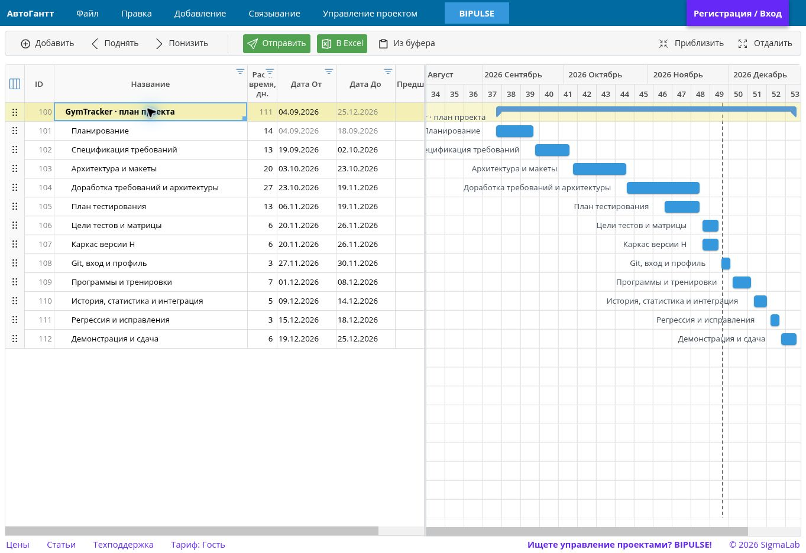

# GymTracker · План проекта

[Редакция на вики](https://se.cs.petrsu.ru/w/index.php?oldid=340587).

[На страницу проекта](00_Start.md)

## Описание проекта

GymTracker - веб-приложение для учёта тренировок, хранения результатов и отслеживания физического прогресса пользователей. Система позволяет создавать тренировочные программы, записывать результаты выполненных упражнений и анализировать изменение показателей во времени.

Основная цель проекта - предоставить пользователю удобное средство для ведения тренировочного дневника и наблюдения за собственным прогрессом. В отличие от обычной записи результатов, приложение должно автоматически формировать историю тренировок, рассчитывать основные показатели и отображать их в удобном виде.

Дополнительно система предусматривает элементы социального взаимодействия: пользователи смогут просматривать разрешённую информацию о друзьях и сравнивать некоторые показатели. При наличии времени планируется реализовать AI-помощника, который сможет использовать сохранённые данные пользователя для формирования общих рекомендаций и ответов на вопросы о тренировках.

Предметной областью проекта являются фитнес и силовые тренировки, составление тренировочных программ, учёт результатов выполнения упражнений и анализ изменения физических показателей пользователя.

## Основные функции

- **Управление пользователем и его профилем:** пользователь имеет возможность зарегистрироваться и авторизоваться в системе, просмотреть и изменить данные своего профиля, указать рост, вес и цель тренировок, а также управлять доступностью основной информации профиля для других пользователей.

<!-- -->

- **Ведение тренировок и тренировочных программ:** пользователь имеет возможность создать собственную тренировочную программу, добавить в неё упражнения, указать количество подходов и повторений, создать запись о проведённой тренировке, указать рабочий вес и количество выполненных повторений, а также просмотреть ранее сохранённые тренировки.

<!-- -->

- **Просмотр и анализ прогресса:** пользователь имеет возможность просмотреть историю тренировок, статистику по упражнениям, количество проведённых тренировок и изменение рабочего веса, а также просмотреть графики основных показателей, личные рекорды и полученные достижения.

<!-- -->

- **Социальные и дополнительные функции:** после реализации основной функциональности пользователь сможет добавлять других пользователей в друзья, просматривать доступную информацию друзей и сравнивать некоторые результаты. При наличии времени предусматриваются групповые рейтинги, дополнительные уведомления и AI-помощник для анализа тренировочных данных и формирования общих рекомендаций.

## Участники проекта

- Менеджер проекта:
  - **Гудаев Умалат Идрисович**, студент 3-го курса.
    Навыки: технический английский (средний уровень), Python (начальный уровень), HTML/CSS (начальный уровень), Git (начальный уровень).
- Секретарь:
  - **Мамедов Захид Илхамович**, студент 3-го курса.
    Навыки: технический английский (средний уровень), Python (начальный уровень), HTML/CSS (начальный уровень), Git (начальный уровень).
- Разработчики:
  - **Акмамедов Халык**, студент 3-го курса.
    Навыки: технический английский (средний уровень), Python (начальный уровень), SQL (начальный уровень), Git (начальный уровень).
  - **Рагимов Самир Шаир оглы**, студент 3-го курса.
    Навыки: технический английский (средний уровень), JavaScript (начальный уровень), HTML/CSS (начальный уровень), Git (начальный уровень).

Все участники команды принимают непосредственное участие в разработке программного обеспечения. Роли менеджера и секретаря являются дополнительными и не освобождают участников от задач разработки.

### Зоны ответственности разработчиков

- **Управление проектом, серверная часть и интеграция компонентов:** Гудаев Умалат.
- **Социальные функции и проектная документация:** Мамедов Захид.
- **База данных и модуль тренировок:** Акмамедов Халык.
- **Пользовательский интерфейс, статистика и визуализация прогресса:** Рагимов Самир.
- **Анализ и уточнение требований:** все участники проекта.
- **Тестирование системы:** все участники проекта.

Указанные зоны ответственности определяют основное направление работы участника, однако при необходимости разработчики могут совместно выполнять задачи, затрагивающие несколько компонентов системы.

## Ограничения на процесс разработки

- **Временное ограничение:** проект выполняется в течение одного учебного семестра. К моменту итоговой аттестации должны быть завершены разработка основной функциональности, тестирование и подготовка документации. Ограниченный срок требует реализации наиболее важных функций в первую очередь и наличия времени на исправление ошибок перед защитой.

<!-- -->

- **Состав команды:** команда состоит из четырёх студентов. Небольшой размер команды ограничивает возможность параллельной разработки большого числа независимых компонентов. Каждый участник отвечает за собственное основное направление, но при этом должен участвовать в интеграции и тестировании общей системы.

<!-- -->

- **Ограничение навыков:** участники проекта являются студентами 3-го курса и не имеют большого опыта разработки крупных веб-систем. Часть технологий будет изучаться непосредственно во время работы над проектом. По этой причине архитектура приложения и используемые технологии должны оставаться достаточно простыми для освоения и сопровождения командой.

<!-- -->

- **Ограничение объёма проекта:** основной задачей является создание работающей системы для ведения тренировок и просмотра прогресса. Функции, не являющиеся необходимыми для основного сценария работы, могут быть упрощены или исключены при недостатке времени.

<!-- -->

- **Технические ограничения:**
  - система разрабатывается в виде веб-приложения;
  - клиентская и серверная части разрабатываются раздельно и взаимодействуют через HTTP API;
  - для хранения данных используется PostgreSQL;
  - отдельное мобильное приложение для Android или iOS в рамках проекта не разрабатывается;
  - синхронизация с фитнес-браслетами и умными часами не предусматривается;
  - распознавание упражнений и анализ техники выполнения по видео не предусматриваются;
  - работа AI-помощника зависит от внешнего сервиса, поэтому основные функции приложения не должны зависеть от его доступности.

<!-- -->

- **Ограничение первой версии:** в обязательную версию GymTracker входят регистрация и авторизация, просмотр и редактирование собственного профиля, просмотр справочника упражнений, создание и изменение тренировочных программ, запись упражнений и подходов, сохранение тренировок, просмотр истории и базовой статистики. Базовая статистика включает количество проведённых тренировок и изменение максимального рабочего веса выбранного упражнения. В первую очередь реализуются соответствующие функциональные требования с высоким приоритетом (H).

<!-- -->

- **Дополнительная функциональность:** после завершения обязательной версии предусматриваются функции со средним приоритетом (M): расширенные показатели и графики, история измерений массы тела, личные рекорды, достижения, друзья и административные функции. Возможности с низким приоритетом (L), включая группы, рейтинги, уведомления и AI-помощника, реализуются при наличии времени. Отсутствие этих дополнительных функций не должно препятствовать использованию основных возможностей GymTracker.

<!-- -->

- **Модель разработки:** используется каскадная модель. Основные этапы выполняются последовательно: определение требований, проектирование, разработка, тестирование и исправление ошибок. Из-за выбранной модели особое внимание уделяется формулировке требований и проектированию до начала основной разработки.

## Временной план работ

Срез 26.11.2026. Первые пять строк отражают историю проектирования, следующие две — отчётную неделю, остальные — плановые сроки команды.

| Этап | Начало | Окончание | Ответственные | Результат | Основание / статус |
|---|---|---|---|---|---|
| Планирование | 04.09.2026 | 18.09.2026 | Гудаев, команда | Тема, роли, границы, исходный план. | Первоначальный план и протоколы №1–2. |
| Спецификация требований | 19.09.2026 | 02.10.2026 | Акмамедов, команда | Первичная редакция ФТ, ФО и сценариев. | Протоколы №3–4. |
| Архитектура и макеты | 03.10.2026 | 23.10.2026 | Гудаев, Рагимов, Акмамедов | Первичная архитектура, данные и макеты. | Протоколы №5–7. |
| Доработка требований и архитектуры | 23.10.2026 | 19.11.2026 | Все участники | Сверены требования, переходы экранов, методы, файлы и контракты. | Доработка по протоколам №7–10 и редакции 19.11. |
| План тестирования | 06.11.2026 | 19.11.2026 | Мамедов, Акмамедов, Рагимов | Стенд, три уровня тестов, входы и ожидаемые результаты. | Подготовка к контрольной точке 16.11 и уточнения 19.11. |
| Цели тестов и матрицы | 20.11.2026 | 26.11.2026 | Мамедов, Акмамедов, Рагимов | Цели 79 тестов и матрицы UT, IT, AT. | Материалы периода 20–26.11. |
| Каркас версии H | 20.11.2026 | 26.11.2026 | Гудаев, Акмамедов, Рагимов, Мамедов | Страница состояния, API, схема 0001 и проверки. Части готовы к первичной публикации. | Архив шага от 20.11 и подготовка публикации до 26.11. |
| Git, вход и профиль | 27.11.2026 | 30.11.2026 | Гудаев, команда | Собрать первый шаг в Git. Начать регистрацию, вход и профиль, подготовить IT-01 и AT-01. | План на ближайшую точку 30.11. |
| Программы и тренировки | 01.12.2026 | 08.12.2026 | Акмамедов, Рагимов, Гудаев | Сохранить программу, записать занятие с подходами и открыть его по id. | План реализации H. |
| История, статистика и интеграция | 09.12.2026 | 14.12.2026 | Рагимов, Акмамедов, Мамедов | Две записи в истории, счётчик 2, рабочие максимумы 32 и 34 кг. Представить нулевую версию кода и связать журнал с коммитом. | План к точке 14.12. |
| Регрессия и исправления | 15.12.2026 | 18.12.2026 | Мамедов, владельцы модулей | Прогнать обязательные сценарии и ограничения, исправить ошибки и повторить проверки. | План подготовки к сдаче. |
| Демонстрация и сдача | 19.12.2026 | 25.12.2026 | Гудаев, команда | Показать работающий дневник, передать руководства и журнал контрольной сборки. | Внутренний срок 25.12 находится в учебном окне 15–28.12. |

### Диаграмма Ганта

До 19 ноября команда уточняла документацию по замечаниям к экранам, методам и связям требований. Первый исполнимый каркас представлен архивом от 20 ноября. К 30 ноября в план включены общий репозиторий и начало реализации входа и профиля.

### Решения по итогам 13 ноября

Инструктор разрешил начинать кодирование. Команда завершает согласование Wiki и использует следующий порядок реализации.

1.  Гудаев и Акмамедов фиксируют миграции базовых сущностей, механизмы сессий, единый формат ошибки и справочник. Рагимов подключает общую оболочку, маршруты и обработку состояний. Мамедов готовит тестовые роли и сценарий входа.
2.  Первый сквозной сценарий — регистрация, вход и профиль. Следующий — пустой план, изменение полного состава и повторное чтение. После него — одно занятие с тремя подходами и открытие подробностей в истории.
3.  Когда контрольные занятия дают число 2 и максимумы 32 и 34 кг, команда показывает обязательный путь и проверяет ограничения доступа и откат записи. Затем включаются дополнительные функции M по одной. Сроки L зависят от готовности основной версии.
4.  Автор изменения запускает блочные проверки, владелец соседнего модуля проверяет интеграцию. Конфликт или сбой регистрируется в журнале с указанием сборки и входных данных.

Проверяемые результаты описаны в [плане тестирования](03_Test_Plan.md). Замечания и распределение работ — в [протоколе №10](https://se.cs.petrsu.ru/wiki/GymTracker:_%D0%9F%D1%80%D0%BE%D1%82%D0%BE%D0%BA%D0%BE%D0%BB_%D1%81%D0%BE%D0%B1%D1%80%D0%B0%D0%BD%D0%B8%D1%8F_%E2%84%9610_-_13.11.26).

### Учебные контрольные точки

| Срок по графику ТППО | Материалы и работы |
|---|---|
| 16.11.2026 | Нулевая версия документа проектирования, начало планирования тестов, сводный и индивидуальные отчёты. |
| 30.11.2026 | Рабочие версии документа проектирования и плана тестирования, трассируемость, начало кодирования и блочного тестирования. |
| 14.12.2026 | Нулевые версии кода, журнала выполнения тестирования и руководства пользователя, начало интеграционного тестирования. |
| 15–28.12.2026 | Сдача артефактов и аттестация ПО. |

Для сборки используется GNU make. Цели установки зависимостей, миграций, запуска и проверок описаны в [проекте сборки](01_Architecture.md#build).

## Формы отчетности и взаимодействия

- Отчётные собрания с инструктором проводятся по пятницам в 11:30 в **341**.
- Обсуждение текущих вопросов проекта проводится в общей беседе команды в Telegram.
- При необходимости проводятся онлайн-встречи команды.
- Для хранения и совместного редактирования документации проекта используется Wiki ТППО.
- К учебным контрольным точкам и ближайшей встрече менеджер обновляет [отчёт о текущем состоянии проекта](https://se.cs.petrsu.ru/wiki/GymTracker:_%D0%9E%D1%82%D1%87%D0%B5%D1%82_%D0%BE_%D1%82%D0%B5%D0%BA%D1%83%D1%89%D0%B5%D0%BC_%D1%81%D0%BE%D1%81%D1%82%D0%BE%D1%8F%D0%BD%D0%B8%D0%B8).
- Каждый участник команды ведёт [индивидуальный отчёт](https://se.cs.petrsu.ru/wiki/GymTracker:_%D0%98%D0%BD%D0%B4%D0%B8%D0%B2%D0%B8%D0%B4%D1%83%D0%B0%D0%BB%D1%8C%D0%BD%D1%8B%D0%B5_%D0%BE%D1%82%D1%87%D0%B5%D1%82%D1%8B) о выполненной работе.
- Важные решения, принятые на встречах с инструктором, фиксируются в [протоколах собраний](https://se.cs.petrsu.ru/wiki/GymTracker:_%D0%9F%D1%80%D0%BE%D1%82%D0%BE%D0%BA%D0%BE%D0%BB%D1%8B_%D1%81%D0%BE%D0%B1%D1%80%D0%B0%D0%BD%D0%B8%D0%B9).
- Ответственным за контроль общего хода проекта является Гудаев Умалат Идрисович.
- Ответственным за оформление протоколов и сопровождение проектной документации является Мамедов Захид Илхамович.
